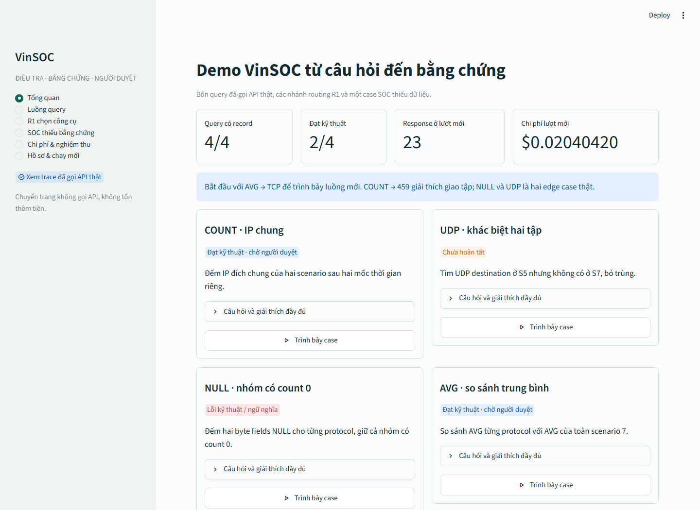

# Giao diện demo VinSOC cho mentor

Giao diện thống nhất tại `scripts/vinsoc_demo_app.py`, dùng các response API thật
đã lưu. Mặc định không cần API key hoặc DB trên máy để xem. Chuyển trang, đổi case,
xem SQL, evidence, assessment và tải artifacts không gọi API, không tính thêm tiền.

## Khởi động

Tại thư mục dự án, dùng đúng Python trong `.venv`:

```powershell
.\.venv\Scripts\python.exe -m pip install -r requirements-demo.txt
.\.venv\Scripts\python.exe -m streamlit run scripts/vinsoc_demo_app.py
```

Mở `http://localhost:8501`. Nếu đang chạy app cũ, dừng process đó bằng Ctrl+C rồi
khởi động lại để nhận theme mới. Entry point `scripts/vinsoc_demo_dashboard.py`
cũng mở cùng giao diện; không còn hai bảng trình bày khác nguồn.



## Demo đủ các case chính trong 15–20 phút

| Màn hình | Thao tác | Điều giải thích với mentor |
|---|---|---|
| Tổng quan | Xem bốn case, chọn AVG | 4 records; 2 đạt kỹ thuật, 1 failed, 1 partial. Demo coverage khác pipeline32. |
| R1 chọn công cụ | Mở 001, 004, 003, 005, 007, 022 và 002 | Network, CTI, endpoint, nhiều tool, no-tool và routing sai thật. Đối chiếu câu hỏi / expected calls / predicted calls. |
| Luồng query: AVG | Đi lần lượt tám bước bằng Bước tiếp | Câu hỏi → native tool call → schema/value → SQL → typed TCP → evidence → assessment/verification → human review. |
| Luồng query: COUNT | Mở SQL, candidate responses và result | DISTINCT, strict time và giao hai tập. Trả 459; producer của run trước giữ riêng. |
| Luồng query: NULL | Mở result và assessment | DB trả 0 hàng vì WHERE làm mất nhóm 0; SQL chạy được nhưng EX false. Response assessment rỗng bị từ chối. |
| Luồng query: UDP | Xem SQL, result và trạng thái | 9.780 rows, full rows giữ nguyên, phân trang 50 hàng. Payload lớn làm pipeline dừng trước assessment/scorer. EX chưa chấm. |
| SOC thiếu bằng chứng | Mở hai native calls và kết quả tools | no_match khác unavailable. Model API thật, dữ liệu synthetic; verdict insufficient_evidence. |
| Chi phí & nghiệm thu | Lọc từng case, xem IDs / usage / model / latency | Giữ cả tiền cho response invalid và partial. Tách EX, facts, provenance, technical và human review. |
| Hồ sơ & chạy mới | Tải case/report, mở workflow nguồn | Hash và producer đối chiếu được. Lượt mới cần scope/authorization/preflight riêng; scope đã consumed không chạy lại. |

Luồng AVG là ví dụ thành công kỹ thuật mới để mentor theo dõi. Case NULL, UDP,
routing 002 và SOC insufficient_evidence là edge cases thật để trình bày giới hạn.
Không cam kết TCP độc hại hoặc host sạch khi thiếu context.

## Người duyệt thật

Ở bước 8, người duyệt tự nhập identity, decision, rationale và UTC ISO 8601
(`Z` hoặc `+00:00`). Các ô để trống mặc định, không tự chọn approved. Rationale
là lý do quyết định dựa trên SQL, kết quả và evidence. Identity là tự khai báo,
chưa phải đăng nhập có xác thực.

Review lưu riêng ở `.vinsoc/mentor-reviews/<case_id>.json`, liên kết SHA-256 bytes
của case gốc. Không sửa artifact, không ghi đè review và không tự duyệt case lỗi.
Case chưa đạt có thể bị từ chối hoặc escalated; chỉ case đạt đủ technical gates
được approved. Chuyển case đặt lại bước đầu và xóa inputs review cũ.

Upload review JSON chỉ để đối chiếu, không tự nhập vào ledger. Review hash mismatch,
identity thiếu, malformed hoặc duplicate được hiển thị, không nâng trạng thái.

## Nguồn và phạm vi

- Bốn query: `results/evaluation_v1/text2sql_integration_v1/mentor_four_case_demo_20261013/`.
- R1 dev: `results/evaluation_v1/r1/r1_a1_dev_v2_852e543.json`, đối chiếu benchmark dev gốc.
- SOC: `results/evaluation_v1/soc_traces_v1/demo_e2e/SCT-087094_S1.json` và `demo_execution_receipt.json`.
- R2 DB/gold: `original_data_20261010/real_data_validation.json`; worker proof từ `/proc` / cgroup ở `offline_release_20261010/r2_independent_kernel_observation.json`.
- Bốn query kiểm hashes trước khi hiển thị case. Missing/partial/duplicate/tampered
  không được thay bằng prediction hoặc assessment dựng tay.

Calibration 0/48, evaluation 0/192, pipeline32 NOT_RUN và human review pending được
giữ rõ. Chi phí query-demo tích lũy không phải số dư tài khoản nhà cung cấp.

## Kiểm chứng thay đổi

```powershell
.\.venv\Scripts\python.exe -m pytest tests/test_vinsoc_demo_data.py tests/test_vinsoc_demo_ui.py tests/test_query_pipeline_reporting.py tests/test_query_cli_viewer.py -q
.\.venv\Scripts\python.exe -m compileall -q scripts/vinsoc_demo_app.py scripts/vinsoc_demo_dashboard.py scripts/vinsoc_demo_data.py
.\.venv\Scripts\python.exe scripts/verify_query_preservation.py
git diff --check
```

Các tests dùng traces thật đang có; mutations/review fixtures chỉ nằm trong thư
mục tạm của pytest, không là model predictions hoặc human decisions thật.
AppTest chặn SDK client initialization khi duyệt trang. Kiểm trình duyệt xem
desktop/mobile, bước DB/assessment, R1 và SOC; không submit review thật.
CI full suite và required offline guards cài dependency demo đã pin, kiểm trên
Python 3.11/3.12. Required real-data jobs tiếp tục kiểm DB/worker riêng.

Targeted reporter/viewer và UI/data: **62 passed, 0 skipped**. Full suite Windows
quan sát **1377 passed, 39 failed, 5 skipped**, không được ghi PASS: 35 failures
do thiếu POSIX `fcntl`, 2 do quyền tạo symlink (WinError 1314), 2 do checkout
CRLF khác raw hash lịch sử. Đối chiếu Git blobs xác nhận hai files chỉ khác
CRLF; giữ nguyên protected files và các lock cũ. Lượt local full bắt đầu trước
test cuối được thêm; CI đúng SHA là kiểm full trên source bàn giao cuối cùng.
Tên toàn bộ failures và receipts ở
`results/evaluation_v1/text2sql_integration_v1/mentor_interface_20261013/verification_receipt.json`.
