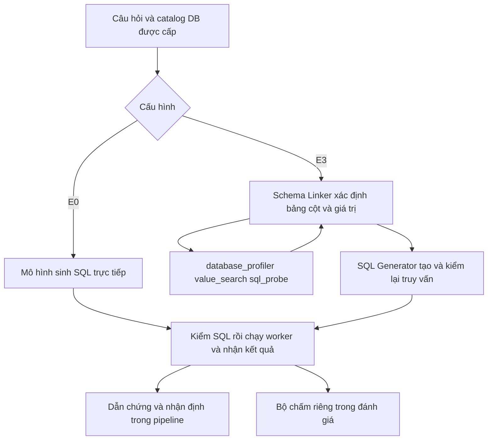

# VinSOC Kịch bản giới thiệu kiến trúc và demo

Cập nhật ngày 14/10/2026. Thời lượng dự kiến 15–20 phút, sau đó trao đổi với mentor.

Kịch bản đi từ bài toán điều tra đến kiến trúc R1/R2, rồi dùng những lượt chạy thật để giải thích hệ thống làm được gì và còn vướng ở đâu. Phần thao tác chỉ ghi những điểm cần mở trên màn hình; lệnh khởi động và hồ sơ đối chiếu nằm ở cuối tài liệu.

## 1. Vì sao xây dựng VinSOC — 1 phút

*Mở trang Tổng quan.*

Khi nhận một cảnh báo, người phân tích thường phải tra nhiều nguồn trước khi có thể đưa ra nhận định. Họ cần biết địa chỉ IP này đã được ghi nhận ở đâu, có những kết nối nào và có dấu hiệu liên quan trên máy trạm hay không. Với một câu hỏi về dữ liệu mạng, họ còn phải xác định bảng, cột và viết truy vấn phù hợp.

VinSOC được xây dựng để hỗ trợ những bước đó. R1 phụ trách lựa chọn công cụ và tham số; R2 chuyển câu hỏi bằng ngôn ngữ tự nhiên thành SQL. Kết quả được lưu cùng nguồn dữ liệu, sau đó đưa vào bước nhận định và kiểm chứng. Người phân tích vẫn là người quyết định cuối cùng.

Trong buổi demo, em sẽ bắt đầu bằng kiến trúc chung, trình bày cách R1 và R2 hoạt động, rồi mở một câu hỏi đã đi hết luồng trên dữ liệu CTU-13 thật. Các ví dụ còn lại sẽ giúp giải thích những lỗi hệ thống đã gặp và hướng xử lý tiếp theo. Hiện đã có bằng chứng cho luồng câu hỏi network; việc kết hợp đầy đủ CTI, network và endpoint trong cùng một sự cố thật vẫn chưa được nghiệm thu.

## 2. Các thành phần phối hợp với nhau như thế nào — 2 phút


Ở giữa sơ đồ là `InvestigationOrchestrator`, bộ điều phối chung của hệ thống. Cảnh báo hoặc IOC đi vào qua `investigate()`, còn câu hỏi về dữ liệu mạng đi vào qua `investigate_query()`. Hai đường vào dùng cấu hình công cụ phù hợp với đầu vào, rồi đưa kết quả về các bước lưu dẫn chứng, nhận định và kiểm chứng.

Với IOC, mô hình có thể chọn công cụ CTI, network hoặc endpoint. Với câu hỏi network, công cụ mới `network_query` nhận nguyên văn câu hỏi và gọi `TextToSQLService`. Đây cũng là dịch vụ được bộ đánh giá R2 sử dụng. Nhờ vậy, phần được đo và phần được tích hợp dùng chung thuật toán sinh SQL, thay vì có một bản riêng chỉ phục vụ demo.

SQL do mô hình tạo ra được kiểm tra trước khi đưa vào `SqlExecutor`. Worker thực thi chỉ được đọc database đã cấp và bị giới hạn về mạng, tài nguyên, thời gian chạy. Kết quả sau đó đi vào `EvidenceStore`, nơi lưu dữ liệu cùng thông tin về snapshot, truy vấn và nguồn tạo ra nó.

Từ những dẫn chứng này, mô hình viết nhận định. Hệ thống kiểm tra số liệu và tham chiếu trong nhận định, rồi giữ hồ sơ cho người duyệt. Cần phân biệt hai việc: nhận định có khớp dữ liệu đã nhận hay không, và SQL có trả lời đúng câu hỏi hay không. Một nhận định có thể diễn giải chính xác kết quả của một truy vấn sai.

Các ví dụ trên giao diện đều là kết quả API đã lưu. Việc mở lại hồ sơ không gọi mô hình thêm và không tự tạo quyết định của người duyệt.

## 3. R1 lựa chọn nguồn điều tra — 3 phút

*Mở trang R1 chọn công cụ.*

R1 nhận yêu cầu cùng mô tả và schema của các công cụ. Mô hình trả về lời gọi hàm gồm tên công cụ và tham số; hệ thống kiểm tham số trước khi chuyển cho công cụ thực thi. Cấu hình được chọn trên bộ dev dùng `gpt-4.1-mini-2025-04-14`.

Ba công cụ có vai trò khác nhau. `cti_enrichment` tra thông tin đe dọa về IP, domain hoặc hash. `network_investigation` làm việc với luồng mạng của một IPv4 cụ thể. `endpoint_investigation` dùng khi cần xem host, process hoặc sự kiện trên máy trạm. Một yêu cầu có thể cần phối hợp các nguồn này, trong khi câu hỏi về chức năng của sản phẩm có thể không cần tra cứu.

Ở `case_001`, yêu cầu là kiểm tra lượng kết nối của DNS server `10.0.0.53`. Mô hình chọn `network_investigation` và giữ đúng IP. Sang `case_005`, yêu cầu có cả IOC `185.220.101.45` và host `WS023`; mô hình trả đủ ba lời gọi CTI, network và endpoint. Hai ví dụ này cho thấy R1 có thể lựa chọn một nguồn hoặc nhiều nguồn theo nội dung yêu cầu.

`case_022` chỉ hỏi các công cụ hỗ trợ loại đầu vào nào. Mô hình không gọi công cụ, phù hợp với mục đích của câu hỏi. Đây cũng là một quyết định cần đánh giá, vì gọi công cụ không cần thiết vẫn làm tăng thời gian và chi phí.

Tuy nhiên, `case_002` cho thấy R1 còn nhầm giữa các mục đích điều tra. Yêu cầu cần xác minh IP thuộc một nhà cung cấp đáng tin, nên đáp án yêu cầu tra CTI; mô hình lại chọn network. Lỗi xuất hiện ngay ở bước chọn nguồn, trước khi có DB hoặc SQL worker. Chưa có thí nghiệm tách riêng nguyên nhân sâu hơn, nên chưa thể kết luận rằng chỉ sửa mô tả công cụ là đủ khắc phục.

Trên bộ dev, R1 đạt **22/24 case**, exact-call F1 **0,9508** và đúng cả **5 case không cần công cụ**. Các kết quả này cho thấy khả năng lựa chọn công cụ và giữ tham số trong phạm vi đã đo. Tuy vậy, bộ dữ liệu còn nhỏ và 11/24 gold đã được xử lý sau khi xem đầu ra ban đầu. Đây chưa phải phép đo trên tập kiểm tra độc lập; R1 frozen vẫn chưa chạy.

Cũng cần giữ đúng phạm vi của kết quả: artifact R1 chứng minh lời gọi mà mô hình trả về, chưa chứng minh cả ba công cụ cùng thực thi thành công trong một sự cố. Điểm 22/24 được đo với schema công cụ cũ, nên không được dùng làm điểm routing của profile `network_query` mới.

## 4. R2 chuyển câu hỏi thành truy vấn — 3 phút

R1 quyết định cần tra nguồn nào. Khi công cụ được chọn là `network_query`, R2 tiếp nhận câu hỏi và tìm cách lấy câu trả lời từ database đã cấp. Công cụ chỉ nhận câu hỏi; mô hình không được tự đưa vào SQL hoặc đường dẫn database.



R2 có hai cấu hình để đối chiếu. **E0** sinh SQL trực tiếp từ câu hỏi và catalog, chỉ cần một request. **E3** bổ sung bước Schema Linker để xác định bảng, cột và giá trị liên quan trước khi SQL Generator tạo truy vấn.

Trong E3, `database_profiler` cung cấp thông tin bảng/cột, `value_search` tìm giá trị được lưu thật và `sql_probe` kiểm truy vấn thử. Những công cụ này giúp mô hình làm việc với dữ liệu cụ thể, nhưng đồng thời tạo thêm yêu cầu về lời gọi hàm, bằng chứng giá trị và định dạng JSON. Mỗi bước đều chịu giới hạn về số lượt gọi, thời gian và kích thước kết quả.

Hai cấu hình dùng `gpt-5-mini-2025-08-07` và cùng executor. Đáp án chuẩn chỉ được bộ chấm đọc sau khi runtime trả kết quả; nó không nằm trong đầu vào sinh SQL. Mô hình routing và viết nhận định của query profile là `gpt-4.1-mini-2025-04-14`.

### Kết quả hiện tại nói gì về hai cấu hình

Lượt calibration đã tạo đủ **24 case × 2 điều kiện = 48 records thật**. Khi cập nhật tài liệu, archive, hash của các binding files, hash records, mã nguồn producer và tổng số liệu của selection đã được đối chiếu độc lập.

| Cấu hình | Execution accuracy (EX) | Số lượt gọi mô hình | Chi phí thực |
|---|---:|---:|---:|
| E0 | 15/24 = 62,5% | 24 | $0.01872625 |
| E3 | 2/24 = 8,33% | 108 | $0.14963190 |

Với bộ này, E0 trả lời đúng nhiều hơn và có chi phí thấp hơn. E3 tốn khoảng tám lần tiền, nhưng **21/24 case không có SQL cuối**. Đầu ra ghi nhận 9 `INVALID_LINKED_SCHEMA`, 10 `MODEL_PARSE_ERROR`, 1 `SAFETY_REJECTION` và 1 `SEMANTIC_REJECTION`. Chỉ 3 case có category `OK`, trong đó 2 case đạt EX. Như vậy, phần lớn lỗi xảy ra trước khi có truy vấn cuối để thực thi, chứ không thể quy toàn bộ điểm thấp cho executor.

Có thể thấy rõ vấn đề ở `ctu_cross_94d3c478d5858048`. Đến bước linker cuối, mô hình nói sẽ chạy `value_search`, nhưng trả văn bản thay cho lời gọi hàm hoặc JSON hợp lệ. Lúc này bộ điều khiển đã yêu cầu kết thúc việc dùng công cụ, nên quá trình không nhận được đầu ra phù hợp để tiếp tục. Cần xem lại sự phối hợp giữa linker, hợp đồng đầu ra và thời điểm bộ điều khiển yêu cầu kết thúc.

Không response nào trong lượt này mang `finish_reason=length`. Vì vậy, dữ liệu hiện có chưa cho thấy tăng giới hạn token đầu ra là cách khắc phục chính. Việc cần làm trước là phân loại đúng lỗi và kiểm tra những bước khiến E3 dừng, rồi mới đánh giá thay đổi nào thực sự cải thiện chất lượng.

Selection trong archive chọn **E0**, nhưng mốc nghiệm thu calibration vẫn chưa đóng: artifacts chưa được nhập vào đường dẫn chính thức và giới hạn token/lượt gọi thực tế khác kế hoạch cũ. Evaluation còn **0/192 records**, pipeline chính thức còn **0/32 case**. Các demo E3 dưới đây là những lượt lịch sử có producer riêng, không thay cho phép đo pipeline32 bằng E0 đã chọn.

## 5. Theo một câu hỏi từ đầu đến cuối — 4 phút

*Mở Luồng query và chọn COUNT · IP chung.*

Câu hỏi gốc là:

> Count distinct destination IPs receiving TCP flows after 2011-08-15 17:00:00 in CTU scenario 5 and after 2011-08-16 14:00:00 in scenario 7; use strict time boundaries.

Người dùng muốn đếm số IP đích khác nhau có TCP flow trong cả hai scenario, sau hai mốc thời gian riêng. Từ “after” và yêu cầu “strict time boundaries” có nghĩa SQL phải dùng dấu `>` ở cả hai mốc.

Trên màn hình đầu tiên, ta thấy mô hình chọn `network_query` và giữ nguyên câu hỏi trong arguments. Công cụ sau đó gọi R2. Ở bước liên kết schema, các trường liên quan gồm `dst_ip`, `protocol`, `source_dataset` và `event_time` trong bảng `network_flows`. Scenario được xác định qua `source_dataset`; trường `label` lại biểu diễn nhãn hành vi của flow.

Sang phần SQL, truy vấn dùng `COUNT(DISTINCT dst_ip)` để tránh đếm lặp. Hai mệnh đề `EXISTS`, nối bằng `AND`, yêu cầu cùng một IP xuất hiện trong S5 và S7 theo điều kiện riêng của từng scenario. Cả hai nhánh đều giữ TCP và biên thời gian nghiêm ngặt.

Worker chạy truy vấn trên dữ liệu thật và trả về một hàng, một cột `BIGINT`, giá trị **459**, không bị cắt. Kết quả này được lưu cùng snapshot, SQL hash và result hash, rồi chuyển thành dẫn chứng trong `EvidenceStore`. Mô hình dựa vào dẫn chứng đó để viết nhận định.

Ở bước kiểm chứng, EX, nguồn và dữ kiện của record này đều đạt. Tuy nhiên, **459 chỉ là số IP thỏa điều kiện truy vấn**, chưa phải số IP độc hại. Muốn đưa ra kết luận an ninh còn cần CTI, ngữ cảnh endpoint và đánh giá của người phân tích.

Cuối cùng là bước người duyệt. Hồ sơ vẫn chờ quyết định; form không có danh tính, lý do hay thời gian được điền sẵn. Người duyệt phải tự xem câu hỏi, SQL, kết quả và nhận định trước khi quyết định.

Ví dụ COUNT cho thấy R2 đã hoạt động bên trong public orchestrator: câu hỏi đi qua lời gọi công cụ, dịch vụ sinh SQL, worker, lưu dẫn chứng và bước nhận định. Hồ sơ cho phép người xem lần ngược từ kết luận về dữ liệu đã dùng.

Record trong bộ bốn demo thuộc run **38338493466**, producer `0d81337…`, có **7 lượt gọi** và chi phí **$0.00739705**. Nếu cần mở lượt COUNT gửi từ Live UI, chọn `liveui-9d9844c08417492a976eb360`: run **38444497641**, **8/8 responses**, **$0.00766320**, cũng trả 459. Đây là hai execution khác nhau; không trộn số liệu hoặc gọi lại mô hình khi mở hồ sơ.

## 6. Những ví dụ còn lại giúp nhìn rõ giới hạn — 3 phút

*Mở lần lượt AVG, NULL và UDP trong Luồng query.*

### AVG và tính ổn định của quá trình sinh SQL

AVG hỏi protocol nào ở S7 có trung bình outbound bytes lớn hơn trung bình của toàn scenario. Lượt đã lưu trả **TCP**, đạt EX và hoàn tất kỹ thuật, hiện chờ người duyệt.

Tuy nhiên, một lượt Live UI sau đó lại dừng ở SQL probe. Mô hình dùng biểu thức trong `HAVING` mà không group hoặc aggregate phù hợp, nên worker báo lỗi. Lượt này nhận 3 responses, tốn **$0.00139010**, nhưng không có SQL cuối hoặc nhận định hợp lệ.

Hai execution được giữ riêng. Trường hợp này cho thấy hạn chế ở truy vấn do mô hình tạo trong bước probe; nguồn DB vẫn có mặt. Một lần thành công chưa đủ chứng minh quá trình sẽ ổn định ở các lượt khác.

### NULL và sự khác nhau giữa chạy được với trả lời đúng

Ở case NULL, SQL hợp lệ và thực thi thành công, nhưng trả về **0 hàng**. Điều kiện `WHERE` đã lọc các flow trước `GROUP BY`, làm mất những nhóm protocol cần được giữ với count bằng 0 theo contract của case. Vì vậy EX bằng false.

Lỗi này thuộc ngữ nghĩa truy vấn. Kiểm tra an toàn có thể chặn thao tác nguy hiểm, nhưng chưa đủ xác định SQL đã diễn đạt đúng câu hỏi. Nhận định của mô hình còn thiếu observations và bị query policy từ chối, nên hồ sơ giữ trạng thái thất bại kỹ thuật.

### UDP và giới hạn khi kết quả lớn

UDP yêu cầu tìm IP đích có trong S5 nhưng không có trong S7, không lặp. Worker đã trả đủ **9.780 hàng**, không cắt kết quả. Tuy nhiên, dữ liệu gửi sang bước nhận định vượt giới hạn **32 KiB** của query policy, nên pipeline dừng trước call assessment.

Điểm nghẽn ở đây nằm trong cách chuyển kết quả sang bước nhận định. Hồ sơ giữ trạng thái chưa hoàn tất và EX chưa được chấm; chưa có cơ sở kết luận SQL sai. Hướng cần nghiên cứu là giữ kết quả đầy đủ trong artifact, đồng thời cung cấp cho mô hình một phần tổng hợp có thể truy nguồn. Cách này chưa được triển khai trong demo hiện tại.

Bốn ID demo đã được chọn trước khi xem đầu ra. Bộ đã lưu có hai case đạt kỹ thuật, một chưa hoàn tất và một thất bại; chưa có human approval. Chúng giúp giải thích hành vi cụ thể, nhưng không thể dùng tỷ lệ 2/4 để suy ra độ chính xác của toàn hệ thống. Khi một bước lỗi, việc giữ hồ sơ và dừng đúng chỗ giúp người xem biết phần nào đã chạy, phần nào chưa có kết quả.

## 7. Kết quả đạt được và hướng phát triển — 2 phút

Qua các ví dụ, VinSOC đã có một luồng câu hỏi đi từ lựa chọn công cụ đến SQL, dữ liệu, dẫn chứng và nhận định bằng API cùng database thật. R1 có kết quả khả quan trên bộ dev; R2 đã được đưa vào public orchestrator thông qua dịch vụ dùng chung. Nhật ký request/response, token, thời gian và chi phí giúp kiểm lại từng lượt chạy. Worker cũng đã được kiểm bằng quan sát kernel độc lập, thay vì chỉ tin thông tin do executor tự báo.

Phần cần cải thiện tập trung ở ba điểm: lựa chọn nguồn đôi lúc chưa đúng, E3 thường dừng trước khi có SQL cuối, và kết quả lớn chưa đi hết được bước nhận định. Những lỗi về NULL và nhóm có count bằng 0 còn cho thấy cần kiểm tra ngữ nghĩa truy vấn kỹ hơn. Các cơ chế kiểm chứng hiện tại giúp phát hiện hoặc giữ lại một số lỗi; chúng chưa bảo đảm mọi câu hỏi đều được trả lời đúng.

Trước mắt, cần hoàn tất việc công bố calibration và selection lock, ghi rõ khác biệt protocol, rồi chạy bộ evaluation **96 case với cả E0/E3** và pipeline **32 case với E0 đã chọn** khi đủ điều kiện và quyền ngân sách riêng. Kết quả phải giữ nguyên mẫu số, hồ sơ lỗi và chi phí, đồng thời cần người thật duyệt những case hợp lệ.

Trong đợt cải tiến sau, R1 cần được đo trên bộ kiểm tra chưa dùng để xác định rõ lỗi chọn nguồn và tham số. Với E3, nên tách lỗi parse, schema và giá trị, bảo đảm linker thu đủ bằng chứng trước khi yêu cầu JSON cuối. Hiệu quả của thay đổi phải được đánh giá bằng số case có SQL cuối, EX, thời gian và chi phí; không chỉ bằng việc giảm lỗi định dạng.

Đối với truy vấn khó, cần bổ sung kiểm tra các trường hợp NULL, nhóm rỗng, phép giao/hiệu và biên thời gian. Với kết quả lớn, cần thiết kế cách đưa dữ liệu vào nhận định mà vẫn giữ đủ hàng và cho phép kiểm lại mọi số liệu. Việc mở rộng sang CTI hoặc endpoint phải dựa vào nguồn thật và có nghiệm thu riêng.

Các thay đổi thuật toán, prompt hoặc công cụ phải thuộc một đợt đánh giá mới. Không sửa runtime sau khi xem kết quả rồi gán điểm cũ cho bản đã sửa, cũng không chạy lại để chọn một câu trả lời đẹp hơn.

> Kết quả hiện tại cho thấy VinSOC đã tích hợp được một luồng điều tra có thể kiểm tra lại từ câu hỏi đến nhận định. Bước tiếp theo là hoàn tất phép đo và review, sau đó cải thiện đúng những môđun đang gây lỗi. Em muốn dùng các hồ sơ này để chỉ rõ hệ thống mạnh ở đâu, còn yếu ở đâu và mỗi thay đổi cần được chứng minh như thế nào.

## Phụ lục chuẩn bị demo và đối chiếu nguồn

### Mở giao diện

Đồng bộ master mới nhất và giữ các thay đổi cá nhân. Khởi động giao diện bằng lệnh:

```powershell
.\.venv\Scripts\python.exe -m streamlit run scripts/vinsoc_demo_app.py `
  --server.address=127.0.0.1 --server.port=8501
```

Mở `http://localhost:8501`, chuẩn bị các trang **Tổng quan**, **R1 chọn công cụ** và **Luồng query**. Nếu trình bày saved Live UI execution, tải và mở trước giờ demo. Không tạo lượt API mới hoặc chuẩn bị sẵn một quyết định approved cho buổi trình bày.

### Các ID và hồ sơ dùng trong demo

- COUNT: `ctu_cross_708b66575657429a`.
- AVG: `ctu_cross_bce6d3679ade4cd6`.
- NULL: `ctu_cross_3f659571f998adb0`.
- UDP: `ctu_cross_66b8e92a76c3359b`.
- [Bốn ID đã khóa](../../results/evaluation_v1/text2sql_integration_v1/demo_selection.json) và [bộ demo đã lưu](../../results/evaluation_v1/text2sql_integration_v1/mentor_four_case_demo_20261013/demo_summary.json).
- [COUNT của bộ demo](https://github.com/Whats-up-pro/VinSOC/actions/runs/38338493466), [COUNT Live UI](https://github.com/Whats-up-pro/VinSOC/actions/runs/38444497641) và [AVG Live UI bị lỗi](https://github.com/Whats-up-pro/VinSOC/actions/runs/38442744166).

### Mã nguồn và bằng chứng thực nghiệm

- Kiến trúc: [orchestrator](../../agent/orchestrator.py), [schema R1](../../agent/tools.py), [query policy](../../agent/network_query_policy.py), [query skill](../../skills/network_query_skill.py), [dịch vụ R2](../../vinsoc_text2sql/service.py), [DB tools](../../evaluation/r2_cross_domain_v1/tool_schemas.py).
- R1: [winner lock cùng giới hạn phép đo](../../evaluation/tool_calling/winner_lock.json) và [24 kết quả](../../results/evaluation_v1/r1/r1_a1_dev_v2_852e543.json).
- [Calibration run 38507847503](https://github.com/Whats-up-pro/VinSOC/actions/runs/38507847503) và [artifact 11868639648](https://github.com/Whats-up-pro/VinSOC/actions/runs/38507847503/artifacts/11868639648). Archive SHA-256: `9bef410dd8c68a566f62c62b7195118a9dff8e587f9740ac673a9a6c1f15adcd`; selection hash: `1a3dad0ca074aeae1581d178110861d8c2a608e22c8be4ab348855fb9e8dcc94`.
- [Selection verifier](../../evaluation/finalization/query_runtime_validation.py), [receipt trước công bố](../../results/evaluation_v1/text2sql_integration_v1/calibration_promotion_20261014/blocked_receipt.json), [checkpoint audit](../../results/evaluation_v1/text2sql_integration_v1/calibration_promotion_20261014/telemetry_audit.json) và [quan sát worker độc lập](../../results/evaluation_v1/text2sql_integration_v1/offline_release_20261011/).
- Calibration nhận 132 responses; 310.479 input, 58.502 output và 116.736 cached tokens. Chi phí lượt này $0.16835815; tổng known cost đã ghi nhận $0.25897065. Các con số này không phải số dư tài khoản hoặc quyền chi tiếp.
- Mốc mã và hồ sơ đã đối chiếu: `32a0f4bbe12e7bf1d8bea05fffca3548b2b818c8`. [CI 38513077523](https://github.com/Whats-up-pro/VinSOC/actions/runs/38513077523) đạt trên Python 3.11/3.12: mỗi phiên bản có 1.433 passed/7 skipped trong full suite; required guards 137 passed/0 skipped; real-data 13 passed/0 skipped.
- 13 DB gốc đúng checksum và 120 gold SQL replay đã đạt. Replay kiểm dữ liệu/executor, không phải 120 câu trả lời do model sinh. Calibration có 48 records trong archive nhưng chưa đóng mốc nghiệm thu; evaluation 0/192, pipeline chính thức 0/32 và human approval của bốn demo bằng 0.
- [Báo cáo Live UI](VinSOC_Live_UI_Acceptance_2026-10-14.md) là hồ sơ lịch sử trước calibration; các số `0/48` trong đó không phản ánh tiến độ mới nhất. Trace SOC dùng dữ liệu synthetic không được dùng làm ví dụ nghiệm thu dữ liệu thật trong kịch bản này.

Hướng dẫn vận hành chi tiết nằm trong [Mentor Demo Interface](VinSOC_Mentor_Demo_Interface_2026-10-13.md) và [Live Interface](VinSOC_Live_Interface_2026-10-14.md).
