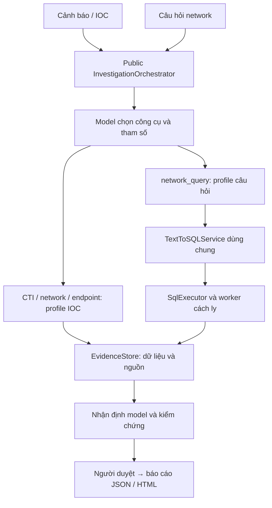
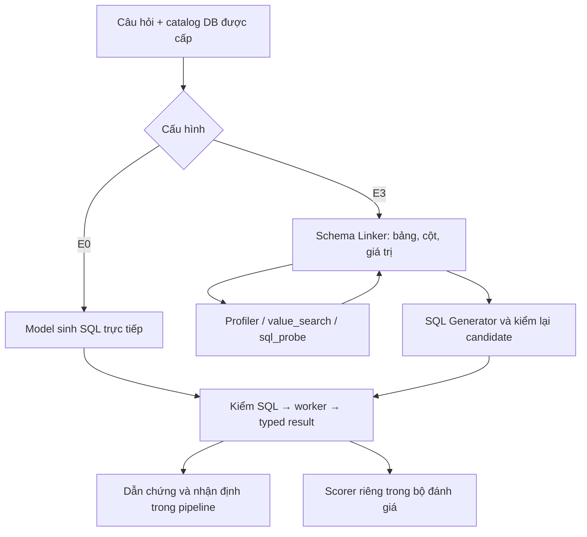

# VinSOC — Kịch bản giới thiệu kiến trúc và demo cho mentor

Cập nhật: 14/10/2026. Thời lượng: 15–20 phút, sau đó hỏi đáp.

**Mạch trình bày:** Bài toán → kiến trúc chung → R1 → R2 → một luồng thật → các giới hạn có bằng chứng → kết luận và cải tiến.

Buổi trình bày dùng lại kết quả API và dữ liệu thật đã lưu. Mở giao diện không gọi thêm model. Bốn ID demo giữ nguyên; người duyệt chưa quyết định thì giữ trạng thái chờ duyệt. Hướng dẫn vận hành nằm ở phụ lục.

## 1. Bài toán và giá trị của hệ thống — 1 phút

**Mở trang Tổng quan. Nói:**

> Khi nhận một cảnh báo hoặc câu hỏi điều tra, analyst cần biết phải tra nguồn nào, tìm dữ liệu gì và kết luận dựa vào đâu. VinSOC chia công việc này thành hai phần: R1 chọn công cụ và tham số; R2 biến câu hỏi thành SQL để lấy dữ liệu. Kết quả đi qua bước lưu dẫn chứng, nhận định của model, kiểm chứng và người duyệt trước khi xuất báo cáo.

> Giá trị cần chứng minh là giảm thao tác tra cứu và giữ được đường đi từ câu hỏi đến kết luận. Một câu trả lời nghe hợp lý chưa đủ; người xem phải kiểm lại được SQL, dữ liệu, nguồn và giới hạn của nó.

**Phạm vi hiện tại:** nhánh câu hỏi network đã có ví dụ chạy từ đầu đến cuối trên CTU-13 S5/S7 thật. Kết quả R1 cho ba công cụ là phép đo riêng. Chưa có bằng chứng rằng toàn bộ CTI, network và endpoint đều hoàn tất trong cùng một sự cố thật.

## 2. Kiến trúc chung — 2 phút



| Thành phần | Trách nhiệm | Điều cần giải thích |
|---|---|---|
| Public orchestrator | Nhận đầu vào, điều phối công cụ và các bước điều tra | IOC dùng `investigate()`; câu hỏi dùng `investigate_query()` trên cùng orchestrator |
| R1 / lựa chọn công cụ | Chọn nguồn cần tra và tạo lời gọi hàm | Chọn đúng công cụ chưa có nghĩa dữ liệu hoặc kết luận đã đúng |
| R2 / Text-to-SQL | Chọn bảng/cột/giá trị phù hợp và sinh SQL | Bộ đánh giá và `network_query` gọi cùng `TextToSQLService`, không có bộ sinh SQL riêng để demo |
| SqlExecutor | Kiểm SQL và thực thi trên DB được cấp | Model không tự chọn đường dẫn DB; SQL chạy trong worker chỉ đọc, tách khỏi process giữ secret |
| EvidenceStore và kiểm chứng | Gắn nguồn, SQL/result hash; kiểm dữ kiện và dẫn chứng | Kiểm số liệu khớp kết quả không tự chứng minh SQL trả lời đúng câu hỏi |
| Người duyệt và viewer | Xem hồ sơ, đưa quyết định; mở báo cáo đã lưu | Không tự phê duyệt; viewer đọc artifacts, không tạo prediction hoặc nhận định mới |

**Nói khi chỉ vào sơ đồ:**

> Có hai đường vào nhưng dùng chung nền điều phối và dẫn chứng. Nhánh IOC giữ ba công cụ cũ. Nhánh câu hỏi thêm `network_query` để dùng chính môđun R2. Vì profile và schema công cụ khác nhau, điểm R1 lịch sử không được gán thành điểm routing của profile mới.

Nguồn mã: [orchestrator](../../agent/orchestrator.py), [query policy](../../agent/network_query_policy.py), [query skill](../../skills/network_query_skill.py), [dịch vụ R2](../../vinsoc_text2sql/service.py).

## 3. R1: chọn đúng công cụ — 3 phút

### Kiến trúc và luồng xử lý

R1 nhận yêu cầu cùng mô tả/schema công cụ. Cấu hình thắng trên bộ dev dùng `gpt-4.1-mini-2025-04-14`. Model trả lời gọi hàm nguyên gốc gồm tên công cụ và tham số. Hệ thống kiểm tham số rồi mới chuyển sang công cụ thực thi. Một yêu cầu có thể cần một nguồn, nhiều nguồn hoặc không cần tra cứu.

| Công cụ trong profile IOC | Dùng khi cần |
|---|---|
| `cti_enrichment` | Tra thông tin đe dọa về IP, domain hoặc hash |
| `network_investigation` | Điều tra luồng mạng của một IPv4 cụ thể |
| `endpoint_investigation` | Điều tra host, process hoặc sự kiện endpoint |

`network_query` thuộc profile câu hỏi mới. Nó nhận đúng câu hỏi gốc, không nhận SQL hay đường dẫn DB do model đưa vào.

### Minh họa trên trang R1 chọn công cụ

| Case | Yêu cầu và kết quả thật | Ý nghĩa |
|---|---|---|
| `case_001` | Điều tra lượng kết nối của DNS server `10.0.0.53`; model chọn `network_investigation` đúng IP | Chọn được nguồn network theo mục tiêu điều tra |
| `case_005` | IOC `185.220.101.45` và host `WS023`; model trả đủ CTI, network, endpoint | Một yêu cầu có thể cần nhiều nguồn; phải giữ được tham số của từng lời gọi |
| `case_022` | Hỏi công cụ hỗ trợ loại đầu vào nào; model không gọi công cụ | Không phải câu hỏi nào cũng cần truy cập dữ liệu |
| `case_002` | Cần xác minh IP thuộc nhà cung cấp đáng tin; đáp án yêu cầu CTI nhưng model chọn network | Có thể nhầm mục đích tra danh tính/reputation với điều tra kết nối |

**Nói:**

> R1 đạt 22 trên 24 case dev, exact-call F1 là 0,9508 và đúng cả 5 case không cần công cụ. Điểm mạnh được quan sát là lựa chọn công cụ và giữ tham số trong các tình huống này. Case 002 cho thấy hạn chế ở quyết định chọn nguồn, không phải DB hoặc SQL worker: model đã chọn sai công cụ trước khi đến các bước đó.

Nguyên nhân sâu hơn của nhầm lẫn trong `case_002` chưa được thí nghiệm tách riêng; không khẳng định chỉ sửa mô tả công cụ là sẽ hết lỗi. Các tham số được chấm đạt không có nghĩa mọi yêu cầu mới đều được bảo toàn đúng.

**Giới hạn phép đo:** 24 case dev còn nhỏ; 11/24 gold đã được xử lý sau khi xem output ban đầu. Đây không phải tập kiểm tra độc lập. R1 frozen chưa được chạy. Artifact R1 chứng minh lời gọi model trả về, không chứng minh ba công cụ cùng thực thi thành công trong một sự cố.

Nguồn: [winner lock và caveats](../../evaluation/tool_calling/winner_lock.json), [24 kết quả R1](../../results/evaluation_v1/r1/r1_a1_dev_v2_852e543.json), [schema công cụ](../../agent/tools.py).

## 4. R2: từ câu hỏi đến SQL và dữ liệu — 3 phút

### Hai cấu hình cần phân biệt



**E0:** một request sinh SQL từ câu hỏi và catalog. Ít bước, ít chi phí; không có bước liên kết giá trị bằng công cụ như E3.

**E3:** Schema Linker xác định bảng/cột và giá trị lưu thật; SQL Generator dùng kết quả đó để sinh truy vấn. `database_profiler` xem thông tin bảng/cột, `value_search` tìm giá trị, `sql_probe` kiểm truy vấn thử. Các bước chịu giới hạn số lượt gọi, thời gian và kích thước kết quả. Nhiều bước tạo khả năng giải thích tốt hơn nhưng cũng thêm điểm có thể lỗi.

Cả hai dùng model R2 `gpt-5-mini-2025-08-07` và cùng executor. Đáp án chuẩn chỉ vào scorer sau khi runtime trả kết quả, không đưa vào prompt sinh SQL. Routing và nhận định của query profile dùng `gpt-4.1-mini-2025-04-14`.

### Kết quả calibration hiện có

Archive của [lượt 38507847503](https://github.com/Whats-up-pro/VinSOC/actions/runs/38507847503) chứa đủ 24 case × E0/E3. Hash 48 binding files, hash records, producer source hashes và totals của selection đã được đối chiếu độc lập khi cập nhật tài liệu này.

| Cấu hình | Execution accuracy (EX) | Model calls | Chi phí thực |
|---|---:|---:|---:|
| E0 | 15/24 = 62,5% | 24 | $0.01872625 |
| E3 | 2/24 = 8,33% | 108 | $0.14963190 |

**Giải thích có bằng chứng:** 21/24 case E3 không có SQL cuối. Mã lỗi gồm 9 `INVALID_LINKED_SCHEMA`, 10 `MODEL_PARSE_ERROR`, 1 `SAFETY_REJECTION`, 1 `SEMANTIC_REJECTION`; chỉ 3 case có category `OK`, trong đó 2 case đạt EX. Lỗi tập trung trước hoặc tại hợp đồng đầu ra, không thể quy toàn bộ điểm thấp cho SQL executor.

Ví dụ `ctu_cross_94d3c478d5858048`: ở bước linker cuối, model nói sẽ chạy `value_search` nhưng trả văn bản thay cho lời gọi hàm/JSON đúng hợp đồng. Bộ điều khiển đã đến bước kết thúc quyền dùng công cụ; bộ phân tích JSON không nhận được đầu ra hợp lệ. Đây là điểm cần kiểm tra phối hợp giữa linker, hợp đồng JSON và bộ điều khiển. Không có response nào mang `finish_reason=length` trong lượt calibration này, nên chưa có bằng chứng rằng tăng giới hạn token đầu ra là cách khắc phục chính.

**Nói:**

> Với lượt calibration này, E0 vừa đúng nhiều hơn vừa rẻ hơn. E3 tốn khoảng tám lần tiền nhưng phần lớn case dừng trước khi có SQL cuối. Vì vậy thêm một agent hoặc thêm công cụ chưa tự tạo cải thiện. Cần sửa và đo đúng điểm lỗi của quá trình liên kết schema, không chỉ tăng ngân sách.

Khóa lựa chọn trong archive chọn **E0**. Tuy nhiên, mốc nghiệm thu calibration **chưa đóng**: artifact chưa được nhập vào đường dẫn chính thức trên master và cấu hình chạy thực tế khác kế hoạch cũ về giới hạn token/lượt gọi. Evaluation vẫn **0/192**, pipeline chính thức **0/32**. Các demo E3 ở phần sau là lượt lịch sử với phiên bản mã nguồn riêng; chúng không thay cho phép đo pipeline32 bằng cấu hình E0 được chọn.

Nguồn: [service](../../vinsoc_text2sql/service.py), [DB tools](../../evaluation/r2_cross_domain_v1/tool_schemas.py), [selection verifier](../../evaluation/finalization/query_runtime_validation.py), [receipt trạng thái](../../results/evaluation_v1/text2sql_integration_v1/calibration_promotion_20261014/blocked_receipt.json). Điểm calibration là kết quả của bộ này, không phải điểm tổng quát trên mọi DB hoặc điểm Spider chính thức.

## 5. Đi trọn một luồng thật: COUNT — 4 phút

**Mở Luồng query → COUNT · IP chung.** Dùng record trong bộ bốn demo đã lưu, producer `0d81337…`, run [38338493466](https://github.com/Whats-up-pro/VinSOC/actions/runs/38338493466). Record này có **7 calls**, chi phí **$0.00739705**. Không trộn nó với lượt COUNT Live UI mới có 8 calls.

**Câu hỏi gốc:**

> Count distinct destination IPs receiving TCP flows after 2011-08-15 17:00:00 in CTU scenario 5 and after 2011-08-16 14:00:00 in scenario 7; use strict time boundaries.

Diễn giải: đếm IP đích khác nhau có TCP flow trong **cả hai scenario**, sau hai mốc thời gian riêng, dùng biên nghiêm ngặt.

| Điểm dừng trên màn hình | Giải thích khi trình bày |
|---|---|
| Câu hỏi và tool call | Model chọn `network_query`; arguments giữ nguyên câu hỏi. Đây là quyết định model thật, không phải script tự gán tên tool |
| Schema/value trajectory | Model làm việc với `network_flows`, `dst_ip`, `protocol`, `source_dataset`, `event_time`. Scenario được biểu diễn bằng `source_dataset`, khác với nhãn hành vi `label` |
| SQL | `COUNT(DISTINCT dst_ip)` tránh đếm lặp; hai `EXISTS` nối bằng `AND` giữ phép giao S5/S7; từng nhánh giữ TCP và mốc `>` riêng |
| Typed result | Worker trả một hàng, một cột `BIGINT`, giá trị **459**, không bị cắt |
| Evidence và assessment | Kết quả tổng hợp liên kết snapshot, SQL hash, result hash và evidence ID; model nhận định dựa trên dẫn chứng đó |
| Kiểm chứng và review | EX, nguồn và dữ kiện đạt; người duyệt vẫn pending. Không tự tạo identity, decision, rationale hoặc UTC |

**Nói khi kết quả 459 hiện ra:**

> Đây là số IP thỏa điều kiện truy vấn, chưa phải 459 IP độc hại. Phép đo EX kiểm SQL có trả lời đúng câu hỏi hay không; kiểm dữ kiện kiểm nhận định có khớp kết quả hay không. Để kết luận an ninh còn cần CTI, endpoint context và quyết định của người thật.

Record thật chứng minh R2 đã nằm trong public orchestrator: lời gọi `network_query` dẫn tới shared service, worker, EvidenceStore và nhận định. Nó không chỉ là script sinh SQL đứng ngoài hệ thống.

Nếu cần chứng minh thao tác từ Live UI, mở execution `liveui-9d9844c08417492a976eb360`: [run 38444497641](https://github.com/Whats-up-pro/VinSOC/actions/runs/38444497641), 8/8 responses, $0.00766320, cũng trả 459. Nói rõ đang xem lại **một execution khác**, không gửi request mới.

## 6. Ba case còn lại: mạnh/yếu ở đâu — 3 phút

Bốn ID được chọn trước khi nhìn output. Cả bốn phải được trình bày, kể cả lỗi; đây là bốn ví dụ giải thích hành vi, không dùng 2/4 để suy ra accuracy của toàn hệ thống.

| Case demo | Kết quả quan sát | Vì sao mạnh hoặc yếu; module liên quan |
|---|---|---|
| **COUNT** `ctu_cross_708b66575657429a` | 459; EX và kỹ thuật đạt; chờ duyệt | R2 biểu diễn đúng phép giao, DISTINCT và biên thời gian; skill chuyển kết quả tổng hợp thành evidence. Thành công của một câu chưa chứng minh đúng mọi phép tập hợp |
| **AVG** `ctu_cross_bce6d3679ade4cd6` | Saved run trả `TCP`; EX và kỹ thuật đạt; chờ duyệt | SQL so trung bình từng protocol với trung bình toàn S7. Lượt Live UI sau đó lỗi probe vì biểu thức trong `HAVING` không được group/aggregate: điểm yếu ở SQL model sinh trong bước probe, không phải DB bị thiếu |
| **NULL** `ctu_cross_3f659571f998adb0` | SQL chạy được nhưng trả 0 hàng; EX false; technical failed | `WHERE` lọc các flow trước `GROUP BY`, làm mất nhóm cần có count 0 theo contract của case. Đây là lỗi ngữ nghĩa SQL; safety gate không chấm được nghĩa câu hỏi. Assessment còn thiếu observations nên bị query policy từ chối |
| **UDP** `ctu_cross_66b8e92a76c3359b` | Giữ đủ 9.780 hàng, không cắt; EX chưa chấm; incomplete | Rows vượt giới hạn 32 KiB khi đưa sang assessment. Điểm nghẽn nằm ở cách chuyển kết quả qua query policy, không phải chứng cứ SQL sai. Worker có kết quả không có nghĩa bước nhận định xử lý được toàn bộ |

**Nói:**

> NULL cho thấy SQL chạy được vẫn có thể sai nghĩa. UDP cho thấy SQL có thể chạy xong nhưng pipeline vẫn chưa hoàn tất vì kết quả quá lớn. AVG cho thấy một lần thành công không bảo đảm execution khác thành công. Việc lưu lỗi và không bịa assessment là điểm mạnh về kiểm toán; đó không phải bằng chứng model chính xác hơn.

Nguồn: [bốn record và lời giải thích](../../results/evaluation_v1/text2sql_integration_v1/mentor_four_case_demo_20261013/demo_summary.json), [AVG Live UI bị lỗi](https://github.com/Whats-up-pro/VinSOC/actions/runs/38442744166). Bộ đã lưu có 2 case đạt kỹ thuật, 1 incomplete, 1 failed; chưa có human approval.

## 7. Kết luận và hướng cải tiến — 2 phút

### Những điểm đã chứng minh và giới hạn

| Điểm | Minh chứng | Kết luận được phép |
|---|---|---|
| Chọn công cụ có ích | R1 22/24; multi-tool và no-tool đúng trong các case đã xem | Có kết quả khả quan trên dev; chưa xác nhận khả năng tổng quát trên tập độc lập |
| Tích hợp R2 vào luồng thật | COUNT/AVG có SQL, typed result, evidence và assessment | Có ví dụ query E2E thật; chưa hoàn tất pipeline32 hoặc cùng lúc đủ ba nguồn SOC |
| Kiểm toán và cách ly | Request/response IDs, usage/cost; worker được kiểm bằng quan sát kernel; 13 DB đúng checksum | Có cơ chế truy nguồn và giới hạn thực thi; không phải cam kết ngăn mọi kiểu tấn công |
| Tách các loại đúng/sai | NULL sai EX; UDP incomplete; review pending được giữ | Runtime, EX, dữ kiện và phê duyệt là các tiêu chí khác nhau |
| Chất lượng R2 chưa ổn định | E3 calibration chỉ 2/24; 21 case không có final SQL | Cần xử lý lỗi đầu ra và controller trước khi tuyên bố E3 cải thiện |

### Phát huy và khắc phục theo thứ tự

| Ưu tiên | Việc cần làm | Cách kiểm chứng cải tiến |
|---|---|---|
| 1. Hoàn tất phép đo hiện tại | Nhập calibration/selection đúng byte, ghi rõ khác biệt protocol; đủ quyền riêng rồi đo 96 case với cả E0/E3 (192 records), sau đó pipeline32 với E0 đã khóa | Đủ mọi ID, mẫu số không đổi, source/config hash khớp; báo lỗi và chi phí thật |
| 2. Củng cố R1 | Tách rõ mục đích CTI/network/endpoint; hoàn tất dữ liệu duyệt độc lập và tập kiểm tra chưa dùng | Đo lỗi chọn nguồn, tham số quan trọng, multi-tool/no-tool trên bộ mới; không sửa gold theo prediction |
| 3. Sửa điểm nghẽn E3 | Tách lỗi parse/schema/value; bảo đảm linker thu đủ bằng chứng giá trị trước khi bộ điều khiển yêu cầu JSON cuối | Giảm số case không có SQL cuối và lỗi hợp đồng, rồi mới đo EX/chi phí; giữ đầu ra lỗi hiện tại để kiểm hồi quy, đo hiệu quả trong đợt mới |
| 4. Tăng kiểm tra ngữ nghĩa | Kiểm trường hợp nhóm có count 0, NULL, phép giao/hiệu và biên thời gian | Chạy SQL đã lưu và test dữ liệu; không dùng đáp án chuẩn trong runtime. Kiểm an toàn và đúng ngữ nghĩa vẫn tách riêng |
| 5. Xử lý kết quả lớn | Giữ toàn bộ kết quả trong artifact; đưa phần tổng hợp có thể truy nguồn cùng liên kết tới kết quả đầy đủ vào assessment | Không mất rows; mọi claim kiểm lại được; đo tỷ lệ hoàn tất và payload. Đây là thiết kế đề xuất, chưa có trong demo UDP |
| 6. Hoàn tất review và mở rộng SOC | Người thật duyệt case hợp lệ; bổ sung CTI/endpoint context khi có nguồn thật | Receipt có identity/decision/rationale/UTC/hash; nghiệm thu từng nguồn, không biến synthetic trace thành dữ liệu sự cố thật |

Các thay đổi model/prompt/công cụ/bộ điều khiển thuộc **đợt cải tiến sau**, có protocol và đánh giá mới. Không sửa runtime sau khi xem kết quả rồi gán điểm cũ cho bản đã sửa; không chạy lại để chọn đầu ra đẹp.

**Lời kết:**

> VinSOC đã chứng minh được một đường đi thật từ câu hỏi đến công cụ, SQL, dữ liệu, dẫn chứng và nhận định. Điểm mạnh là tích hợp môđun dùng chung và khả năng kiểm lại từng bước. Điểm yếu hiện tại là độ ổn định của R2 nhiều bước, ngữ nghĩa SQL khó và giới hạn khi kết quả lớn. Bước tiếp theo là hoàn tất phép đo cùng người duyệt, sau đó cải tiến đúng module gây lỗi và đánh giá trên dữ liệu mới.

## Phụ lục: chuẩn bị màn hình và nguồn kiểm chứng

### A. Chuẩn bị ngắn

Đồng bộ master mới nhất, giữ các thay đổi cá nhân; không checkout ngược về producer của một artifact. Khởi động viewer:

```powershell
.\.venv\Scripts\python.exe -m streamlit run scripts/vinsoc_demo_app.py `
  --server.address=127.0.0.1 --server.port=8501
```

Mở `http://localhost:8501`. Chuẩn bị **Tổng quan**, **R1 chọn công cụ**, **Luồng query** và bảng bằng chứng. Nếu dùng saved Live UI execution, tải/mở trước giờ demo. Không bấm chạy mới hoặc điền sẵn human review để phục vụ buổi trình bày.

Hướng dẫn cài đặt, sức khỏe UI và vận hành chi tiết: [Mentor Demo Interface](VinSOC_Mentor_Demo_Interface_2026-10-13.md), [Live Interface](VinSOC_Live_Interface_2026-10-14.md).

### B. Cue card

1. Bài toán: chọn nguồn → lấy dữ liệu → kết luận có dẫn chứng.
2. Kiến trúc: public orchestrator, hai profile, R2 dùng chung, worker và EvidenceStore.
3. R1: một tool, nhiều tool, no-tool, sai chọn nguồn; 22/24 dev và giới hạn.
4. R2: E0 trực tiếp; E3 linker/tools/generator; 15/24 so với 2/24 calibration.
5. COUNT: đúng câu hỏi → native call → SQL → 459 → evidence → assessment → pending review.
6. AVG/NULL/UDP: lỗi probe, sai ngữ nghĩa, payload lớn; chỉ đúng môđun gây lỗi.
7. Kết: điều đã chứng minh, phần chưa đạt, cải tiến và cách đo lại trên series mới.

### C. Hồ sơ nguồn và trạng thái tại mốc đọc

- Mốc mã/receipts đã đọc: `master@22c9e984d11bbb9a0ac83f004d44f8d2e636b418`. Producer của từng record được giữ riêng.
- [CI 38510854118](https://github.com/Whats-up-pro/VinSOC/actions/runs/38510854118): mỗi Python 3.11/3.12 có 1.433 passed/7 skipped ở full suite; required guards 137 passed/0 skipped; real-data 13 passed/0 skipped. CI xanh không thay nghiệm thu model.
- [R1 winner lock](../../evaluation/tool_calling/winner_lock.json) và [artifact R1](../../results/evaluation_v1/r1/r1_a1_dev_v2_852e543.json).
- [Bốn demo IDs đã khóa](../../results/evaluation_v1/text2sql_integration_v1/demo_selection.json), [bộ demo thật](../../results/evaluation_v1/text2sql_integration_v1/mentor_four_case_demo_20261013/), [kernel observation](../../results/evaluation_v1/text2sql_integration_v1/offline_release_20261011/).
- [Nghiệm thu Live UI](VinSOC_Live_UI_Acceptance_2026-10-14.md): báo cáo lịch sử trước calibration; các số `0/48` và allocation trong tài liệu đó không phải trạng thái mới nhất.
- [Calibration artifact 11868639648](https://github.com/Whats-up-pro/VinSOC/actions/runs/38507847503/artifacts/11868639648), archive SHA-256 `9bef410dd8c68a566f62c62b7195118a9dff8e587f9740ac673a9a6c1f15adcd`; selection hash `1a3dad0ca074aeae1581d178110861d8c2a608e22c8be4ab348855fb9e8dcc94`.
- [Checkpoint audit](../../results/evaluation_v1/text2sql_integration_v1/calibration_promotion_20261014/telemetry_audit.json): calibration 132 responses, 310.479 input/58.502 output/116.736 cached tokens; chi phí $0.16835815, cumulative known $0.25897065. Đây là chi phí đã ghi nhận, không phải số dư provider hay quyền chi tiếp.
- 13 DB gốc và 120 gold SQL replay đã đạt. Replay kiểm dữ liệu/executor, không tạo 120 model predictions. Calibration có 48 records trong archive nhưng chưa đóng milestone; evaluation 0/192, formal pipeline 0/32, human approval của bốn demo bằng 0.
- Trace SOC dùng dữ liệu synthetic không nằm trong phần minh họa nghiệm thu dữ liệu thật của kịch bản này.
