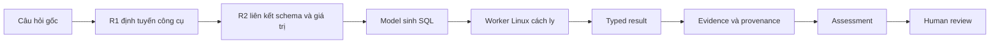

# Kịch bản trình bày VinSOC cho mentor

Ngày chuẩn bị: 14/10/2026  
Thời lượng chuẩn: 20 phút trình bày + 5–10 phút hỏi đáp  
Phiên bản hệ thống đã nghiệm thu trước tài liệu này:
`e8b792006ae6ee04f1696a38f4d51d5d885b68e1`

## 1. Mục tiêu của buổi demo

Sau buổi demo, mentor cần nhìn thấy và hiểu được năm điểm:

1. VinSOC nhận một câu hỏi điều tra, chọn công cụ, sinh SQL, chạy SQL trên dữ liệu thật,
   tạo evidence, assessment và chuyển quyết định cuối cho người duyệt.
2. Model API đã được gọi thật. Mỗi request có role, request/response ID, usage, latency
   và chi phí.
3. SQL của model chạy trong worker Linux cách ly. Streamlit chỉ điều phối và đọc artifact.
4. Hệ thống giữ nguyên cả kết quả thành công, incomplete và failed. Không có prediction,
   assessment hoặc review được tạo để làm đẹp demo.
5. Đây là nghiệm thu bốn demo case và Live UI. Calibration 0/48, evaluation 0/192 và
   pipeline chính thức 0/32 vẫn `NOT_RUN`.

Thông điệp chính có thể dùng để mở và đóng buổi trình bày:

> VinSOC biến một câu hỏi điều tra thành một chuỗi có thể kiểm tra lại: model chọn công
> cụ, tạo truy vấn, worker chạy trên dữ liệu thật, hệ thống lưu evidence và chi phí, rồi
> người thật quyết định. Mỗi gate được báo riêng nên một workflow chạy xong không tự động
> trở thành kết luận an ninh.

## 2. Luồng hệ thống cần giải thích



Nói ngắn gọn khi chỉ vào sơ đồ:

> Model tham gia ở routing, sinh SQL và assessment. Database execution là một ranh giới
> riêng: SQL đi vào worker Linux bị giới hạn network, secret, filesystem, memory, CPU và
> timeout. Kết quả quay lại dưới dạng typed result và evidence. Người duyệt mới là bước
> đưa ra quyết định cuối.

## 3. Chuẩn bị trước giờ demo

### 3.1. Mở PowerShell và kiểm tra đúng phiên bản

Chạy lần lượt:

```powershell
Set-Location D:\VINUNI_AI2026\Phase3_VinSOC
git fetch origin master
git status --short --untracked-files=no
git rev-parse HEAD
git rev-parse origin/master
gh auth status
gh run view 38498704336 --json status,conclusion,headSha,url
```

Kết quả cần thấy:

- `git status --short --untracked-files=no` không in thay đổi tracked.
- `HEAD` và `origin/master` cùng là
  `e8b792006ae6ee04f1696a38f4d51d5d885b68e1`.
- CI `38498704336` có `status=completed`, `conclusion=success` và cùng `headSha`.

Nếu repo đã có commit mới hơn vào ngày demo, không checkout ngược. Chỉ dùng execution
đã lưu để trình bày và nói rõ producer SHA của artifact.

### 3.2. Khởi động giao diện

```powershell
.\.venv\Scripts\python.exe -m pip install -r requirements-demo.txt
.\.venv\Scripts\python.exe -m streamlit run scripts/vinsoc_demo_app.py `
  --server.address=127.0.0.1 --server.port=8501
```

Mở `http://localhost:8501` và kiểm tra sức khỏe ở terminal khác:

```powershell
Invoke-WebRequest -UseBasicParsing http://localhost:8501/_stcore/health
```

Kết quả cần là HTTP 200, body `ok`.

### 3.3. Chuẩn bị bốn tab trình duyệt

1. `http://localhost:8501` — giao diện VinSOC.
2. [CI bàn giao](https://github.com/Whats-up-pro/VinSOC/actions/runs/38498704336).
3. [COUNT live workflow](https://github.com/Whats-up-pro/VinSOC/actions/runs/38444497641).
4. [Báo cáo nghiệm thu](VinSOC_Live_UI_Acceptance_2026-10-14.md).

Không mở raw private journal hoặc API key. Giao diện và public artifacts đã đủ để demo.

## 4. Kịch bản 20 phút: lời nói và thao tác

### 0:00–1:00 — Mở đầu

**Thao tác**

- Mở trang **Tổng quan**.
- Giữ màn hình ở bốn thẻ case.

**Lời trình bày**

> Em sẽ trình bày một luồng end-to-end thành công, sau đó mở các failure path thật để
> cho thấy hệ thống xử lý model error, lỗi ngữ nghĩa, payload lớn và source thay đổi như
> thế nào. Bốn ID demo được khóa từ trước. Viewer chỉ đọc artifacts nên việc chuyển trang
> không gọi API và không tốn thêm tiền.

> Trên màn hình hiện có hai case đạt kỹ thuật và chờ người duyệt, một case incomplete và
> một case technical failed. Đây là trạng thái thật của từng execution, không phải bốn
> ví dụ đều được ép thành success.

**Điểm cần chỉ**

- `Query có record: 4/4` nghĩa là đủ artifact của bốn demo ID.
- `Đạt kỹ thuật: 2/4` nghĩa là hai case đã qua các gate kỹ thuật.
- Trạng thái human review vẫn pending.

**Không nói**

- Không gọi đây là kết quả pipeline32.
- Không gọi 120 gold SQL là 120 model predictions.
- Không gọi technical success là kết luận sự cố an ninh.

### 1:00–3:00 — R1 chọn công cụ

**Thao tác**

- Chọn **R1 chọn công cụ** ở sidebar.
- Mở lần lượt `case_001`, `case_005`, `case_022` và `case_002`.

**Lời trình bày**

> Bước đầu tiên là định tuyến. Model phải xác định câu hỏi cần network telemetry, CTI,
> endpoint, nhiều công cụ hay chưa cần gọi công cụ. Cột trái là yêu cầu benchmark; cột
> phải là native tool call model thực sự trả về.

Khi mở `case_001`:

> Đây là nhánh network. Ta so expected calls với predicted calls và xem scorer xác nhận
> trajectory.

Khi mở `case_005`:

> Một câu hỏi có thể cần nhiều nguồn. VinSOC giữ cả thứ tự và tham số tool calls, thay vì
> chỉ lưu nhãn phân loại cuối.

Khi mở `case_022`:

> No-tool cũng là một quyết định hợp lệ. Hệ thống không bắt model gọi công cụ khi câu hỏi
> không yêu cầu dữ liệu điều tra.

Khi mở `case_002`:

> Đây là routing sai thật được giữ lại. Mục đích của màn hình là cho thấy model đã làm gì
> và scorer đánh giá ra sao, không chỉ trình bày các case đẹp.

**Câu chốt**

> R1 chứng minh quyết định routing trên 24 dev cases. Nó chưa thay thế nghiệm thu holdout
> và cũng chưa chứng minh mọi công cụ đã cùng chạy trong một incident.

### 3:00–4:00 — Xác nhận đây là API run thật

**Thao tác**

- Chọn **Chạy pipeline thật**.
- Trong **Mở / tiếp tục một lượt đã gửi**, chọn
  `liveui-9d9844c08417492a976eb360`.
- Mở link GitHub Actions nếu mentor muốn đối chiếu.

**Lời trình bày**

> Đây là execution COUNT được gửi từ chính giao diện. Preflight của nó gọi 0 model,
> sau đó live run nhận đủ 8 trên 8 responses: một routing, sáu R2 và một assessment.
> Chi phí riêng execution là 0,0076632 USD. Workflow nguồn là run 38444497641.

> API key chỉ tồn tại trong GitHub secret. Streamlit dùng phiên GitHub của operator để
> dispatch và tải artifact; model SDK và SQL worker không chạy trong process giao diện.

**Điểm cần chỉ**

- `Attempted / received: 8 / 8`.
- `Chi phí lượt này: $0.00766320`.
- Workflow URL.
- Bảng event có role, response ID và USD.

### 4:00–10:30 — Đi đủ tám bước của COUNT

Giữ execution `liveui-9d9844c08417492a976eb360`, rồi thay đổi **Bước pipeline thật**
từ 1 đến 8.

#### Bước 1 — Câu hỏi gốc

**Lời trình bày**

> Câu hỏi yêu cầu đếm số IP đích khác nhau nhận TCP flow trong cả CTU scenario 5 và 7,
> với hai mốc thời gian riêng. Cụm “after” được hiểu là điều kiện lớn hơn nghiêm ngặt,
> nên SQL phải dùng dấu `>` ở cả hai mốc.

**Điểm cần chỉ**

- Case ID `ctu_cross_708b66575657429a`.
- Câu hỏi tiếng Anh nguyên gốc.
- Hai scenario và hai timestamp không được hoán đổi.

#### Bước 2 — Native tool call

**Lời trình bày**

> Routing model chọn công cụ truy vấn network. Đây là tool call nguyên gốc, gồm tên hàm
> và arguments, chứ không phải nhãn do viewer dựng lại.

**Điểm cần chỉ**

- Function name.
- Arguments chứa đúng mục tiêu network investigation.

#### Bước 3 — Schema và value trajectory

**Lời trình bày**

> R2 chưa viết SQL ngay. Nó tìm bảng, cột và giá trị liên quan trước, ví dụ
> `network_flows`, `dst_ip`, `protocol`, `source_dataset` và `event_time`. Mỗi bước tool
> và response được lưu để có thể giải thích model đã dựa vào schema nào.

**Điểm cần chỉ**

- Trajectory.
- Linked schema.
- Các response được lưu trước parse.

#### Bước 4 — SQL của model

**Lời trình bày**

> SQL đếm `COUNT(DISTINCT dst_ip)`. Hai mệnh đề `EXISTS` biểu diễn giao tập: cùng một IP
> phải xuất hiện ở S5 sau mốc thứ nhất và S7 sau mốc thứ hai. Cả hai nhánh đều khóa
> `protocol = 'TCP'` và dùng biên thời gian `>`.

> Đây là SQL model sinh ra. Hệ thống lưu candidate và response gốc trước khi parse nên
> nếu parse hoặc execution lỗi, ta vẫn còn checkpoint để điều tra.

**Điểm cần chỉ**

- `COUNT(DISTINCT dst_ip)`.
- Hai `EXISTS`.
- `ctu13_s5`, `ctu13_s7`.
- Hai dấu `>`.

#### Bước 5 — Typed result

**Lời trình bày**

> Worker Linux thực thi SQL trên database thật và trả một hàng, một cột `BIGINT`, giá trị
> 459. `truncated=false`, nên đây không phải preview bị cắt bớt.

> Con số 459 là số IP thỏa điều kiện truy vấn. Nó chưa có nghĩa là 459 IP độc hại.

**Điểm cần chỉ**

- Giá trị `459`.
- Type `BIGINT`.
- `row_count=1` và `truncated=false`.

#### Bước 6 — Evidence và provenance

**Lời trình bày**

> Kết quả được gắn với evidence ID, database/snapshot, SQL hash và result hash. Khi mở
> evidence, ta có thể lần từ assessment về typed result và nguồn tạo ra nó. Đây là phần
> giúp kiểm toán kết luận sau này.

**Điểm cần chỉ**

- Evidence ID và source tool.
- Parent/link relationship.
- SQL/result hash và database identity.

#### Bước 7 — Assessment và các gate độc lập

**Lời trình bày**

> Assessment chỉ được chấp nhận khi dẫn evidence hợp lệ. Bảng gate tách routing, runtime,
> integrated EX, provenance, factual verification, technical workflow và human review.
> Case này đạt kỹ thuật và EX, nhưng hai gate human review vẫn chưa đạt.

> Assessment có thể diễn giải 459 là kết quả truy vấn. Để kết luận rủi ro, analyst vẫn
> cần CTI hoặc endpoint context phù hợp.

**Điểm cần chỉ**

- `integrated_ex=true`.
- Routing, runtime, provenance, factual verification và technical workflow đều đạt.
- Human review coverage và human approved completion chưa đạt.

#### Bước 8 — Human review

**Lời trình bày**

> Hệ thống không tự điền danh tính, quyết định, rationale hoặc thời gian. Người duyệt phải
> tự xem câu hỏi, SQL, typed result và evidence trước khi nhập. Receipt review được khóa
> vào hash của case; duplicate hoặc hash mismatch không được tính.

> `Rationale` là lý do chuyên môn cho quyết định. Ví dụ, nếu người duyệt thực sự đã kiểm
> tra case này, họ có thể ghi rằng SQL giữ đúng hai biên thời gian nghiêm ngặt, phép giao
> S5/S7 và typed result 459, đồng thời ghi rõ kết quả chưa tự chứng minh hành vi độc hại.

**Thao tác**

- Để form trống trong buổi demo nếu mentor không trực tiếp đóng vai người duyệt.
- Nếu mentor muốn duyệt thật, họ tự nhập identity, chọn decision, tự viết rationale và
  nhập UTC hiện tại. Không chuẩn bị sẵn một receipt approved.

### 10:30–14:30 — Các edge case thật

#### Edge case A — Cùng case AVG có một run thành công và một run thất bại

**Thao tác**

1. Vào **Luồng query**, chọn `AVG · so sánh trung bình`.
2. Cho xem saved run thành công: SQL, typed result `TCP`, assessment và pending review.
3. Quay lại **Chạy pipeline thật**, chọn
   `liveui-5ccddb346587414d998fa145` để mở lượt AVG mới thất bại.

**Lời trình bày**

> Saved AVG trước đó đã hoàn tất kỹ thuật với 8 calls và trả `TCP`. Một execution AVG mới
> sau này nhận đủ 3 responses nhưng model sinh SQL probe có lỗi binder trong phần
> `HAVING`. Worker trả lỗi, nên execution mới giữ `TOOL_FAILURE`, không có final SQL và
> không có assessment.

> Hai execution có identity riêng. Giao diện không lấy kết quả AVG cũ để thay cho lần mới
> thất bại. Điều này cũng minh họa rằng một model run có thể biến động; provenance của
> từng run quan trọng hơn tên case.

**Điểm cần chỉ**

- Fresh AVG: `3/3`, `$0.00139010`, `technical_incomplete`.
- Stage SQL ghi `Chưa có final SQL`.
- Assessment ghi chưa có assessment hợp lệ.

#### Edge case B — SQL chạy được nhưng sai ngữ nghĩa NULL

**Thao tác**

- Vào **Luồng query**, chọn `NULL · nhóm có count 0`.
- Mở SQL, typed result và assessment.

**Lời trình bày**

> SQL này hợp lệ về cú pháp và worker chạy thành công, nhưng điều kiện `WHERE` loại các
> hàng trước `GROUP BY`. Vì vậy các protocol cần xuất hiện với count bằng 0 biến mất hoàn
> toàn. Gold contract yêu cầu giữ các nhóm đó, nên integrated EX bằng false.

> Assessment còn trả observations rỗng và bị contract từ chối. Hệ thống giữ trạng thái
> technical failed thay vì coi “SQL chạy không lỗi” là câu trả lời đúng.

#### Edge case C — Kết quả lớn vượt policy assessment

**Thao tác**

- Chọn `UDP · khác biệt hai tập` trong **Luồng query**.
- Mở typed result và trang phân trang.

**Lời trình bày**

> SQL UDP chạy thật và giữ đủ 9.780 hàng, `truncated=false`. Riêng JSON rows đã khoảng
> 186.810 bytes, vượt policy envelope 32 KiB cho assessment. Pipeline dừng trước call
> assessment. Case được giữ `incomplete` và integrated EX là unscored; hệ thống không bỏ
> bớt rows để tạo một trace đẹp.

#### Edge case D — Source đổi sau preflight

**Thao tác**

- Trong **Chạy pipeline thật**, chọn `liveui-2d7feac422f24667928c9789`.

**Lời trình bày**

> Đây là một execution UDP khác. Preflight từng pass với 0 calls, nhưng master thay đổi
> trước live dispatch. Backend chặn `REMOTE_MASTER_CHANGED` trước khi tạo SDK client.
> Kết quả là attempted 0, received 0, client_created false, không claim allocation và
> chi phí bằng 0.

> Source binding ngăn một preflight của phiên bản cũ cấp quyền cho source mới.

### 14:30–16:30 — SOC biết dừng khi thiếu bằng chứng

**Thao tác**

- Chọn **SOC thiếu bằng chứng**.
- Mở native tool calls và kết quả công cụ.

**Lời trình bày**

> Case SOC này dùng dữ liệu synthetic nhưng model API thật. Hai trạng thái cần phân biệt:
> `no_match` nghĩa là đã tra nguồn nhưng không có event khớp; `unavailable` nghĩa là nguồn
> context không tồn tại hoặc không truy cập được. Cả hai đều chưa đủ để kết luận host
> sạch.

> Vì evidence thiếu, assessment đúng là `insufficient_evidence`. Đây là hành vi an toàn:
> hệ thống nói rõ giới hạn và chuyển cho analyst thay vì suy diễn một verdict chắc chắn.

**Câu chốt**

> Một integration case chứng minh hành vi biết dừng. Nó không được dùng để thay điểm toàn
> bộ SOC suite.

### 16:30–18:30 — Chi phí, CI và worker isolation

**Thao tác**

- Chọn **Chi phí & nghiệm thu**.
- Mở bảng cost events.
- Mở hai expander về DB gốc và independent kernel observation.
- Chuyển sang tab CI `38498704336`.

**Lời trình bày**

> Tính đến acceptance này, query allocation có 91 model calls, chi phí xác minh
> 0,09061250 USD và còn 2,90938750 USD trong cap dự án 3 USD. Đây là allocation nội bộ,
> không phải số dư tài khoản OpenAI.

> Cost event liên kết case, condition, role, model, token, latency, request ID và response
> ID. Raw response và usage được checkpoint trước parse nên lỗi parse vẫn không làm mất
> dấu vết chi phí.

> CI cuối chạy cả Python 3.11 và 3.12: full suite 1.432 passed, 7 optional skipped;
> required offline 136 passed, 0 skipped; required real-data và worker checks 13 passed,
> 0 skipped trên mỗi phiên bản. 13 database gốc đúng checksum và 120 gold SQL replay
> thành công. Gold replay là kiểm dữ liệu/executor, không phải model score.

> Worker được kiểm bằng quan sát kernel độc lập: network namespace, không có secret trong
> environment, chỉ mount database cần thiết ở chế độ read-only, process group bị giới hạn
> 512 MiB cùng CPU và timeout. SQL của model không chạy trong process Streamlit.

### 18:30–20:00 — Trạng thái dự án và kết luận

**Thao tác**

- Giữ trang **Chi phí & nghiệm thu** ở bảng gate.
- Nếu còn thời gian, mở **Hồ sơ & chạy mới** để chỉ đường dẫn artifacts và producer.

**Lời trình bày**

> Phần đã chứng minh là Live UI, bốn demo ID, real API receipts, execution trên dữ liệu
> thật, worker isolation, provenance, cost ledger và human-review gate. Hai demo case đạt
> kỹ thuật; các nhánh incomplete và failed vẫn được giữ nguyên.

> Phần chưa chạy chính thức gồm calibration 0 trên 48, selection lock đang pending,
> evaluation 0 trên 192 và pipeline 0 trên 32. Cận bảo thủ của ba scope là
> 153,3843456 USD, lớn hơn allocation còn lại, nên không thể gọi các scope đó là complete
> trong ngân sách hiện tại.

> Kết luận của demo là VinSOC đã chạy được một query end-to-end bằng API và database thật,
> đồng thời báo đúng các giới hạn. Bước tiếp theo của release cần ngân sách riêng cho
> calibration, selection lock, evaluation và pipeline chính thức, sau đó cần human review
> thật trên artifacts tương ứng.

## 5. Nếu mentor yêu cầu “chạy ngay một lượt mới”

Khuyến nghị dùng execution COUNT đã lưu để demo ổn định. Nó vẫn là run API thật và có
workflow, response IDs, usage, cost cùng artifact độc lập. Việc mở lại chỉ đọc artifact.

Nếu mentor yêu cầu quan sát quá trình dispatch trực tiếp:

1. Vào **Chạy pipeline thật**.
2. Chọn scope và case.
3. Giữ nguyên câu hỏi gốc được UI điền.
4. Bấm **Chạy preflight Linux (0 model calls)**.
5. Chờ trạng thái `preflight_pass` và xác nhận:
   `attempted=0`, `received=0`, `client_created=false`.
6. Đọc cost ceiling, role caps, source SHA và CI binding trên màn hình.
7. Chỉ khi scope chưa dùng, source không đổi, preflight đạt và có quyền ngân sách riêng,
   người vận hành mới tự tick consent và bấm **Chạy pipeline API thật**.
8. Theo dõi bảng workflow steps và request checkpoints. Không refresh bằng cách tạo một
   execution khác.

Với trạng thái bàn giao hiện tại, các demo execution đã dùng phải giữ consumed. Không
rerun để cứu output xấu và không dùng quyền của execution cũ cho một lượt mới. Nếu gate
chặn, trình bày receipt blocked như một phần của cơ chế an toàn.

Một câu nói phù hợp khi không dispatch thêm:

> Em đang mở lại execution thật đã chạy, không phát lại request. Workflow ID, response ID,
> usage, cost và artifact hash cho phép kiểm tra đây là kết quả API thật. Việc không rerun
> giúp giữ đúng ngân sách và tránh chọn lại model output chỉ vì lần trước chưa đẹp.

## 6. Mẫu human review để giải thích, không tự điền

Các trường:

- **Identity:** danh tính người thực sự duyệt.
- **Decision:** `approved`, `rejected` hoặc `escalated` theo lựa chọn của người duyệt.
- **Rationale:** lý do dựa trên câu hỏi, SQL, result, evidence và giới hạn.
- **UTC:** thời điểm người đó thực hiện review, định dạng ISO 8601.

Gợi ý cách người duyệt tự viết rationale cho COUNT sau khi họ đã kiểm tra:

> Tôi đã đối chiếu câu hỏi gốc với SQL: hai scenario và hai biên thời gian nghiêm ngặt
> được giữ đúng; phép giao được biểu diễn bằng hai EXISTS; worker trả một BIGINT 459,
> row_count 1, không truncated; evidence liên kết đúng SQL và result hash. Tôi chấp nhận
> kết quả kỹ thuật của truy vấn. Kết quả này chưa tự chứng minh các IP là độc hại.

Không copy câu này thành approval nếu người nhập chưa tự thực hiện review.

## 7. Câu hỏi mentor có thể hỏi

### “459 có phải là 459 địa chỉ độc hại không?”

Không. Đây là số IP đích thỏa điều kiện TCP và thời gian trong hai scenario. Muốn kết luận
độc hại cần thêm CTI, endpoint context và human review.

### “Model được gọi ở đâu?”

Ở routing, R2/Text2SQL và assessment. Live COUNT có 1 routing, 6 R2 và 1 assessment
response. Model SDK chạy trên GitHub Actions; API key nằm trong GitHub secret.

### “Tại sao không chạy SQL ngay trong giao diện?”

SQL là output không tin cậy của model. Worker Linux tách process, network, environment và
filesystem; database được mount read-only, có memory/CPU/timeout limits.

### “Workflow xanh có nghĩa là câu trả lời đúng không?”

Không. Workflow, runtime, integrated EX, provenance, factual verification và human review
là các gate riêng. NULL là ví dụ SQL chạy xong nhưng sai ngữ nghĩa.

### “Tại sao lại cho xem case failed?”

Failed và incomplete là kết quả thực cần audit. Chúng chứng minh pipeline giữ partial
checkpoint và không tự tạo final SQL, assessment hoặc prediction thay thế.

### “Có phải đã hoàn thành evaluation không?”

Chưa. Calibration 0/48, evaluation 0/192 và formal pipeline 0/32 đều `NOT_RUN`.

### “120 gold queries có phải điểm model không?”

Không. SQL gold đã lưu chỉ kiểm database restore và SqlExecutor trên dữ liệu thật.

### “Vì sao full suite có 7 skipped?”

Đó là các optional skips trong full suite. Hai job bắt buộc đều không skip: required
offline 136/0 skip và real-data/isolated-worker 13/0 skip trên Python 3.11 và 3.12.

### “3 USD có đủ chạy toàn bộ formal suite không?”

Không theo cận hiện hành. Allocation còn 2,90938750 USD, trong khi cận bảo thủ của
calibration, evaluation và pipeline cộng lại là 153,3843456 USD.

### “Tại sao AVG lúc được lúc lỗi?”

Đó là hai execution độc lập. Saved AVG hoàn thành; fresh AVG sau đó lỗi ở SQL probe. Mỗi
run có provenance riêng và giao diện không ghi đè run lỗi bằng kết quả cũ.

### “UDP có hai loại lỗi à?”

Đúng, ở hai execution khác nhau. Saved UDP chạy SQL và giữ 9.780 rows nhưng dừng vì
assessment payload policy. Fresh UDP bị chặn trước SDK vì source SHA đổi sau preflight.

## 8. Xử lý sự cố khi trình bày

| Hiện tượng | Cách xử lý | Cách giải thích |
|---|---|---|
| Streamlit chưa mở | Chạy health check, sau đó khởi động lại đúng lệnh ở mục 3.2 | Viewer đọc artifacts; restart không tạo API call |
| GitHub tải chậm | Tiếp tục bằng saved package ở **Luồng query** | Local artifact có manifest và hash đã đối chiếu |
| Fresh session không hiện | Chọn lại execution ID trong **Mở / tiếp tục một lượt đã gửi** | Session lưu bền trên disk |
| Câu hỏi bị sửa | Khôi phục đúng câu hỏi gốc và tạo preflight mới | Input thay đổi làm preflight cũ mất hiệu lực |
| Hiện `REMOTE_MASTER_CHANGED` | Không cố bypass; mở receipt blocked | Source binding đang hoạt động đúng |
| Case không có final SQL | Mở partial trajectory và lỗi | Không tạo SQL giả để tiếp tục |
| Human review vẫn pending | Giữ nguyên nếu chưa có người duyệt thật | Technical success và approval là hai gate riêng |
| Mentor hỏi số liệu chính thức | Mở **Chi phí & nghiệm thu** và CI cuối | Dùng receipt hiện hành, không nhớ số bằng miệng |

## 9. Cue card một trang

Nếu cần một bản cực ngắn để đặt cạnh màn hình, dùng thứ tự sau:

1. **Tổng quan:** 4/4 records; 2 technical pass; 1 incomplete; 1 failed; review pending.
2. **R1:** network → multi-tool → no-tool → một routing sai thật.
3. **Live COUNT:** `liveui-9d9844…`; 8/8; `$0.0076632`; workflow `38444497641`.
4. **Tám bước:** question → tool call → schema/value → SQL → `459 BIGINT` → evidence
   → assessment/gates → manual review.
5. **AVG:** saved success `TCP`; fresh failure 3/3, `$0.0013901`, no final SQL.
6. **NULL:** SQL chạy nhưng sai zero-group semantics; EX false.
7. **UDP:** saved 9.780 rows/payload incomplete; fresh source-change block 0 calls/$0.
8. **SOC:** no_match khác unavailable; `insufficient_evidence` là kết quả đúng.
9. **Chi phí:** 91 calls; `$0.09061250`; còn `$2.90938750`; unknown cost=false.
10. **CI:** 1.432 pass/7 optional skip; required 136/0; real data 13/0 mỗi Python.
11. **Mở:** calibration 0/48; evaluation 0/192; pipeline 0/32; human approvals 0.
12. **Kết:** end-to-end thật đã chứng minh; formal suites cần ngân sách và review riêng.

## 10. Nguồn để trích dẫn trong buổi demo

- CI bàn giao: [GitHub Actions 38498704336](https://github.com/Whats-up-pro/VinSOC/actions/runs/38498704336).
- COUNT live: [GitHub Actions 38444497641](https://github.com/Whats-up-pro/VinSOC/actions/runs/38444497641).
- AVG failure: [GitHub Actions 38442744166](https://github.com/Whats-up-pro/VinSOC/actions/runs/38442744166).
- UDP source-change block: [GitHub Actions 38496491276](https://github.com/Whats-up-pro/VinSOC/actions/runs/38496491276).
- Báo cáo nghiệm thu: `docs/evaluation/VinSOC_Live_UI_Acceptance_2026-10-14.md`.
- Acceptance receipts:
  `results/evaluation_v1/text2sql_integration_v1/live_ui_acceptance_20261014/`.
- Bốn demo records:
  `results/evaluation_v1/text2sql_integration_v1/mentor_four_case_demo_20261013/`.
- Selection cố định:
  `results/evaluation_v1/text2sql_integration_v1/demo_selection.json`.

