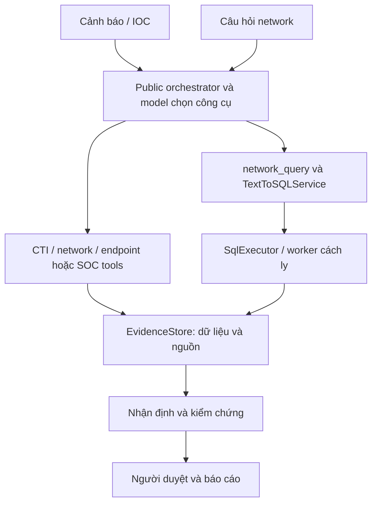
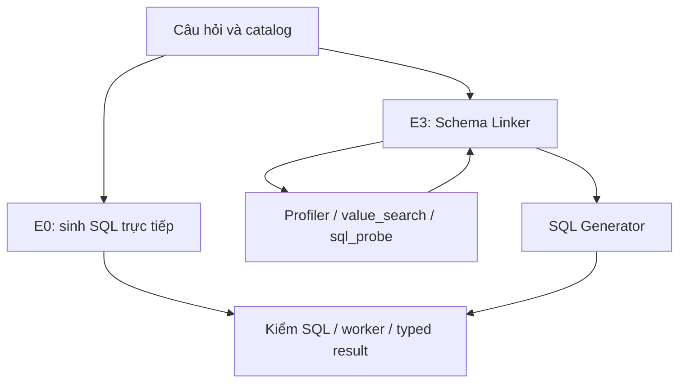
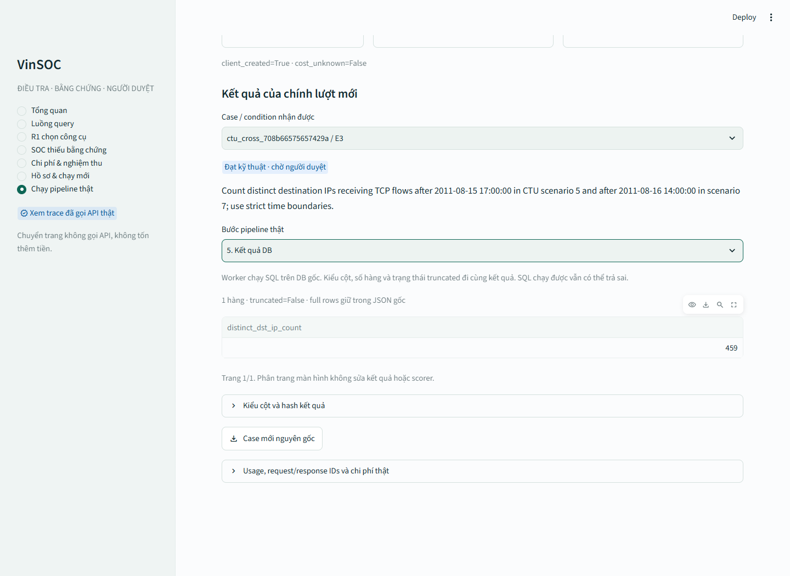

# VinSOC: báo cáo kiến trúc và thực nghiệm cho mentor

Ngày 14/10/2026. Mốc mã và bằng chứng: fc674fa58e6c08d8e40083d79f3921dc779ebf2c. PDF có tỷ lệ 16:9 để chiếu; nội dung và phụ lục dưới đây là bản nguồn.

## VinSOC: kiến trúc và thực nghiệm

Báo cáo hệ thống dành cho buổi trao đổi với mentor. Nội dung được đối chiếu trên master ngày 14/10/2026, tại mốc fc674fa.

R1 22/24; calibration protocol2 E0 15/24, E3 5/24; selection chính thức chọn E0.

VinSOC đã có mô-đun chọn công cụ, dịch vụ Text-to-SQL dùng chung và hồ sơ điều tra sinh từ API thật. Calibration protocol2 đã đủ 48 hồ sơ và chọn E0. Đánh giá 96 câu, luồng chính thức 32 câu và quyết định của người thật vẫn chưa có kết quả nghiệm thu tại mốc này.

Báo cáo trình bày cả kết quả đạt và lỗi đã quan sát. Những con số của calibration, demo riêng và dữ liệu tổng hợp được giữ đúng phạm vi, để người xem có thể lần lại bằng chứng.

Nguồn: [S1](https://github.com/Whats-up-pro/VinSOC/blob/fc674fa58e6c08d8e40083d79f3921dc779ebf2c/docs/superpowers/plans/2026-10-08-vinsoc-text2sql-integration-and-final-demo.md), [S7](https://github.com/Whats-up-pro/VinSOC/blob/fc674fa58e6c08d8e40083d79f3921dc779ebf2c/results/evaluation_v1/text2sql_integration_v1/calibration_protocol2_20261014/acceptance_receipt.json), [S8](https://github.com/Whats-up-pro/VinSOC/blob/fc674fa58e6c08d8e40083d79f3921dc779ebf2c/results/evaluation_v1/text2sql_integration_v1/selection_lock.json), [S10](https://github.com/Whats-up-pro/VinSOC/blob/fc674fa58e6c08d8e40083d79f3921dc779ebf2c/results/evaluation_v1/text2sql_integration_v1/mentor_four_case_demo_20261013/demo_summary.json).

## 1. Bài toán và phạm vi của hệ thống

Khi nhận một cảnh báo hoặc IOC, người phân tích thường phải tra nhiều nguồn trước khi đưa ra nhận định. Họ cần biết sự kiện đã xuất hiện ở đâu, có kết nối mạng nào liên quan và máy trạm đã làm gì. Với một câu hỏi về dữ liệu mạng, họ còn phải chọn bảng, cột và viết truy vấn phù hợp.

VinSOC hỗ trợ hai phần của công việc đó. R1 lựa chọn công cụ và giữ đúng tham số trong yêu cầu. R2 chuyển câu hỏi bằng ngôn ngữ tự nhiên thành SQL trên phạm vi dữ liệu được ứng dụng cấp. Kết quả được lưu thành dẫn chứng, rồi đi vào nhận định, kiểm chứng và bước người duyệt.

| Luồng | Đầu vào và mục đích | Bằng chứng hiện có |
| --- | --- | --- |
| IOC / cảnh báo | Tra thông tin và ngữ cảnh điều tra | Một ca SOC traces có API thật, trên dữ liệu tổng hợp |
| Câu hỏi network | Truy vấn dữ liệu CTU bằng R2 | Bốn demo E3 trên database CTU thật |

Bằng chứng tích hợp hiện tại cho thấy hệ thống đi qua các mô-đun thật. Nó chưa đủ chứng minh hiệu quả điều tra trên mọi sự cố hoặc khả năng khái quát trên mọi database.

Nguồn: [S4](https://github.com/Whats-up-pro/VinSOC/blob/fc674fa58e6c08d8e40083d79f3921dc779ebf2c/agent/orchestrator.py), [S10](https://github.com/Whats-up-pro/VinSOC/blob/fc674fa58e6c08d8e40083d79f3921dc779ebf2c/results/evaluation_v1/text2sql_integration_v1/mentor_four_case_demo_20261013/demo_summary.json), [S20](https://github.com/Whats-up-pro/VinSOC/blob/fc674fa58e6c08d8e40083d79f3921dc779ebf2c/results/evaluation_v1/soc_traces_v1/demo_execution_receipt.json), [S22](https://github.com/Whats-up-pro/VinSOC/blob/fc674fa58e6c08d8e40083d79f3921dc779ebf2c/docs/evaluation/2026-10-08-soc-traces-handoff.md).

## 2. Kiến trúc chung



Hai đường vào dùng public orchestrator. Với câu hỏi network, network_query chỉ nhận nguyên văn câu hỏi; mô hình không được tự chọn đường dẫn DB hoặc đưa SQL vào tham số công cụ. Bộ đánh giá và công cụ này cùng gọi TextToSQLService và SqlExecutor.

Đáp án chuẩn và bộ chấm nằm ở phía đánh giá. Kết quả vận hành đi vào EvidenceStore, nhận định và kiểm chứng. Người duyệt vẫn quyết định cuối cùng.

Nguồn: [S1](https://github.com/Whats-up-pro/VinSOC/blob/fc674fa58e6c08d8e40083d79f3921dc779ebf2c/docs/superpowers/plans/2026-10-08-vinsoc-text2sql-integration-and-final-demo.md), [S4](https://github.com/Whats-up-pro/VinSOC/blob/fc674fa58e6c08d8e40083d79f3921dc779ebf2c/agent/orchestrator.py), [S5](https://github.com/Whats-up-pro/VinSOC/blob/fc674fa58e6c08d8e40083d79f3921dc779ebf2c/vinsoc_text2sql/service.py).

## 3. R1 lựa chọn nguồn điều tra

R1 nhận yêu cầu cùng mô tả và schema công cụ. Mô hình trả lời gọi hàm có tên công cụ và tham số. Hệ thống kiểm cấu trúc và giá trị trước khi chuyển cho công cụ thực thi. Một yêu cầu có thể cần một nguồn, nhiều nguồn hoặc không cần gọi công cụ.

| Công cụ | Mục đích | Đầu vào chính |
| --- | --- | --- |
| cti_enrichment | Tra thông tin đe dọa về IOC | IP, domain hoặc hash |
| network_investigation | Xem luồng mạng của địa chỉ cụ thể | IPv4 và phạm vi được cấp |
| endpoint_investigation | Xem host, process và sự kiện máy trạm | Host / điều kiện trong yêu cầu |

Phép đo R1 hiện có là một lượt quyết định bằng native tool-call objects, dùng gpt-4.1-mini-2025-04-14. Tên công cụ và tham số được so khớp với đáp án. Đây là phép đo quyết định gọi công cụ, chưa phải điểm hoàn tất điều tra của cả ba nguồn.

Profile network_query mới có schema riêng. Vì vậy, điểm R1 cũ không được dùng làm điểm routing của luồng câu hỏi mới.

Nguồn: [S2](https://github.com/Whats-up-pro/VinSOC/blob/fc674fa58e6c08d8e40083d79f3921dc779ebf2c/evaluation/tool_calling/winner_lock.json), [S3](https://github.com/Whats-up-pro/VinSOC/blob/fc674fa58e6c08d8e40083d79f3921dc779ebf2c/results/evaluation_v1/r1/r1_a1_dev_v2_852e543.json), [S4](https://github.com/Whats-up-pro/VinSOC/blob/fc674fa58e6c08d8e40083d79f3921dc779ebf2c/agent/orchestrator.py).

## 4. Kết quả R1 và các tình huống tiêu biểu

| Chỉ số | Kết quả | Ý nghĩa |
| --- | --- | --- |
| Thành công theo tình huống | 22/24 = 91,67% | Đúng tên công cụ và yêu cầu tương ứng |
| F1 lời gọi chính xác | 0,9508 | Có xét tên công cụ và tham số bắt buộc |
| Không gọi công cụ khi không cần | 5/5 | Đúng trên năm câu của bộ phát triển |

| Tình huống | Đầu ra mô hình | Giải thích |
| --- | --- | --- |
| case_001: DNS 10.0.0.53 | network_investigation | Nguồn mạng phù hợp với câu hỏi kết nối |
| case_005: IOC và WS023 | CTI, network, endpoint | Mô hình chọn phối hợp nhiều nguồn |
| case_022: hỏi chức năng | Không gọi công cụ | Không cần tra dữ liệu để trả lời |
| case_002: IP nhà cung cấp | Chọn network thay cho CTI | Lỗi ở bước lựa chọn nguồn, trước DB và SQL |

Bộ phát triển còn nhỏ. Có 11/24 đáp án đã được xử lý sau khi xem đầu ra ban đầu, nên đây chưa phải tập kiểm tra độc lập. R1 frozen chưa chạy; hai lỗi còn lại là case_002 và case_015.

Nguồn: [S2](https://github.com/Whats-up-pro/VinSOC/blob/fc674fa58e6c08d8e40083d79f3921dc779ebf2c/evaluation/tool_calling/winner_lock.json), [S3](https://github.com/Whats-up-pro/VinSOC/blob/fc674fa58e6c08d8e40083d79f3921dc779ebf2c/results/evaluation_v1/r1/r1_a1_dev_v2_852e543.json).

## 5. R2: hai cấu hình và một đường thực thi



E0 sinh SQL trực tiếp từ câu hỏi và catalog bằng một request. E3 thêm Schema Linker, DB tools và SQL Generator để xác định bảng, cột, quan hệ và giá trị trước khi chốt truy vấn. Cả hai dùng gpt-5-mini-2025-08-07 và cùng executor.

Nguồn: [S1](https://github.com/Whats-up-pro/VinSOC/blob/fc674fa58e6c08d8e40083d79f3921dc779ebf2c/docs/superpowers/plans/2026-10-08-vinsoc-text2sql-integration-and-final-demo.md), [S5](https://github.com/Whats-up-pro/VinSOC/blob/fc674fa58e6c08d8e40083d79f3921dc779ebf2c/vinsoc_text2sql/service.py), [S7](https://github.com/Whats-up-pro/VinSOC/blob/fc674fa58e6c08d8e40083d79f3921dc779ebf2c/results/evaluation_v1/text2sql_integration_v1/calibration_protocol2_20261014/acceptance_receipt.json).

## R2: quy trình so sánh đã khóa

| Tham số đã khóa | E0 | E3 |
| --- | --- | --- |
| Mô hình | gpt-5-mini-2025-08-07 | Cùng mô hình |
| Lượt gọi mô hình / câu hỏi | 1 | Tối đa 3 linker + 3 generator |
| Cận output tokens / request | 1.000 | 1.000 |
| Reasoning / retry | low / không retry | low / không retry |
| DB tools | Không dùng probe trung gian | Profiler, value_search, sql_probe; tối đa 12 lượt |

Protocol2 khóa reasoning_effort=low, tối đa 1.000 output tokens mỗi request, không retry. E3 có tối đa ba lượt linker và ba lượt generator, cùng cận 12 DB-tool calls. Profiler, value_search và sql_probe đều dùng worker cách ly.

Tách bộ chấm khỏi runtime giúp hạn chế việc đáp án đi vào đầu vào sinh SQL. Tích hợp dùng cùng dịch vụ giúp phép đo gắn với mô-đun thực sự được hệ thống gọi.

Nguồn: [S1](https://github.com/Whats-up-pro/VinSOC/blob/fc674fa58e6c08d8e40083d79f3921dc779ebf2c/docs/superpowers/plans/2026-10-08-vinsoc-text2sql-integration-and-final-demo.md), [S5](https://github.com/Whats-up-pro/VinSOC/blob/fc674fa58e6c08d8e40083d79f3921dc779ebf2c/vinsoc_text2sql/service.py), [S7](https://github.com/Whats-up-pro/VinSOC/blob/fc674fa58e6c08d8e40083d79f3921dc779ebf2c/results/evaluation_v1/text2sql_integration_v1/calibration_protocol2_20261014/acceptance_receipt.json).

## 6. Dữ liệu và thiết kế phép đo

| Phần | Quy mô | Mục đích |
| --- | --- | --- |
| Bộ chọn cấu hình (calibration) | 24 câu: 16 ngoài SOC + 8 CTU | Chọn E0/E3 trước khi nhìn điểm evaluation |
| Bộ đánh giá mở rộng | 96 câu: external64 + CTU32 | Đo hai cấu hình trên nhiều schema/lĩnh vực |
| Luồng tích hợp chính thức | 32 câu CTU | Đo routing, R2, dẫn chứng, nhận định và review |
| Bốn demo | Bốn ID chọn trước đầu ra | Minh họa hành vi, gồm cả lỗi và chạy dở |

13 database gốc đã được khôi phục đúng checksum. 120 câu SQL chuẩn đã được replay thành công trên DB thật. Việc này kiểm dữ liệu và executor; nó không phải 120 dự đoán đúng của mô hình. CTU S5/S7 có 243.906 network flows.

Bộ evaluation có tám database ngoài SOC, bảy lĩnh vực ngoài SOC và 93 families trong 96 câu. Phân bố độ khó dự kiến là 24 cơ bản, 48 trung bình, 24 nâng cao. Kết quả phải giữ các mẫu số 64/32/96 và báo thêm macro theo database, lĩnh vực, độ khó và nhóm SQL.

Nguồn công khai và cùng các scenario CTU không tạo bảo đảm độc lập với dữ liệu tiền huấn luyện hoặc sự cố mới. Bộ này mở rộng độ phủ của phép đo, không đại diện mọi dữ liệu SOC.

Nguồn: [S1](https://github.com/Whats-up-pro/VinSOC/blob/fc674fa58e6c08d8e40083d79f3921dc779ebf2c/docs/superpowers/plans/2026-10-08-vinsoc-text2sql-integration-and-final-demo.md), [S6](https://github.com/Whats-up-pro/VinSOC/tree/fc674fa58e6c08d8e40083d79f3921dc779ebf2c/evaluation/r2_cross_domain_v1/), [S19](https://github.com/Whats-up-pro/VinSOC/blob/fc674fa58e6c08d8e40083d79f3921dc779ebf2c/results/evaluation_v1/text2sql_integration_v1/original_data_20261010/bundle_restore_receipt.json).

## 7. Calibration chính thức: E0 được chọn

| Chỉ số trên 24 câu mỗi cấu hình | E0 | E3 |
| --- | --- | --- |
| Execution accuracy (EX) | 15/24 = 62,5% | 5/24 = 20,83% |
| Có SQL cuối / chạy thành công | 23/24 | 5/24 |
| Lượt gọi mô hình | 24 | 115 |
| DB-tool calls | 0 | 48 |
| Chi phí thực (USD) | 0.01804825 | 0.14953455 |
| Thời gian tổng theo hồ sơ / trung bình mỗi câu | 124,40 s / 5,18 s | 799,38 s / 33,31 s |

Protocol2 tạo đủ 48 hồ sơ thật và 139/139 phản hồi, không unknown cost. Có 139 request IDs và 139 response IDs duy nhất. Mã băm của 48 binding files và chữ ký canonical selection lock được đối chiếu lại từ file trong repo.

Quy tắc chọn lần lượt xét EX, chi phí, số calls, latency rồi E0 nếu vẫn hòa. E0 có EX cao hơn và chi phí thấp hơn, nên selection lock chọn E0. Đây là kết quả chọn cấu hình; evaluation 96 câu và pipeline32 vẫn là hai phép đo riêng.

Nguồn: [S7](https://github.com/Whats-up-pro/VinSOC/blob/fc674fa58e6c08d8e40083d79f3921dc779ebf2c/results/evaluation_v1/text2sql_integration_v1/calibration_protocol2_20261014/acceptance_receipt.json), [S8](https://github.com/Whats-up-pro/VinSOC/blob/fc674fa58e6c08d8e40083d79f3921dc779ebf2c/results/evaluation_v1/text2sql_integration_v1/selection_lock.json), [S9](https://github.com/Whats-up-pro/VinSOC/tree/fc674fa58e6c08d8e40083d79f3921dc779ebf2c/results/evaluation_v1/text2sql_integration_v1/calibration_protocol2_20261014/), [S17](https://github.com/Whats-up-pro/VinSOC/actions/runs/38527512069).

## 8. Kết quả theo database và so sánh cùng câu

| Database của calibration | n | E0 đúng | E3 đúng |
| --- | --- | --- | --- |
| Quản lý mẫu văn bản | 4 | 4/4 | 2/4 |
| Theo dõi kết quả học tập | 4 | 3/4 | 0/4 |
| voter_1 | 4 | 2/4 | 0/4 |
| world_1 | 4 | 0/4 | 0/4 |
| CTU network | 8 | 6/8 | 3/8 |
| Tổng | 24 | 15/24 | 5/24 |

Ngoài SOC: E0 9/16, E3 2/16. CTU: E0 6/8, E3 3/8. Macro theo năm database calibration, với trọng số bằng nhau, lần lượt là 60,0% và 17,5%. Các tỷ lệ này chỉ mô tả bộ chọn cấu hình; nhiều database chỉ có bốn câu.

Trên cùng 24 ID, có 10 câu chỉ E0 đúng, 0 câu chỉ E3 đúng, 5 câu cả hai đúng và 9 câu cả hai sai. Chênh EX là 41,67 điểm phần trăm. Không có kiểm định khái quát độc lập ở đây; tương quan theo database và lựa chọn mẫu cần được giữ trong cách diễn giải.

Nguồn: [S9](https://github.com/Whats-up-pro/VinSOC/tree/fc674fa58e6c08d8e40083d79f3921dc779ebf2c/results/evaluation_v1/text2sql_integration_v1/calibration_protocol2_20261014/), [S6](https://github.com/Whats-up-pro/VinSOC/tree/fc674fa58e6c08d8e40083d79f3921dc779ebf2c/evaluation/r2_cross_domain_v1/).

## Cập nhật protocol3: vẫn là calibration

| Chỉ số | Protocol2: selection đã công bố | Protocol3: mới kiểm toán artifact |
| --- | --- | --- |
| Hồ sơ / phản hồi thật | 48 / 139 | 48 / 144 |
| EX E0 / E3 | 15/24 / 5/24 | 15/24 / 4/24 |
| E0 chạy SQL thành công | 23/24 | 22/24 |
| E3 chạy SQL thành công | 5/24 | 5/24 |
| Chi phí lượt (USD) | 0.16758280 | 0.17346330 |

Run 38532017308 của protocol3 là calibration 24 câu, không phải evaluation 96 câu. Receipt kiểm toán xác nhận archive digest, 48 bindings, 144 request/response IDs duy nhất và tổng chi phí; chưa có promotion hoặc selection lock mới.

Giữ riêng hai lượt, không lấy điểm tốt nhất ghép thành một kết quả. Semantic-test accuracy ở projection protocol3 là NOT_MEASURED: giá trị mặc định 0 trong report nguồn không phải kết quả thực thi một test ngữ nghĩa.

Báo cáo dùng protocol2 làm mốc selection chính thức và phân tích lỗi chính. Protocol3 là cập nhật lịch sử mới hơn, chưa chứng minh evaluation hoặc pipeline32 đã chạy.

Nguồn: [S27](https://github.com/Whats-up-pro/VinSOC/blob/fc674fa58e6c08d8e40083d79f3921dc779ebf2c/docs/evaluation/VinSOC_Benchmark_Run_Blockers_2026-10-14.md), [S28](https://github.com/Whats-up-pro/VinSOC/tree/fc674fa58e6c08d8e40083d79f3921dc779ebf2c/results/evaluation_v1/text2sql_integration_v1/calibration_protocol3_audit_20261014/), [S7](https://github.com/Whats-up-pro/VinSOC/blob/fc674fa58e6c08d8e40083d79f3921dc779ebf2c/results/evaluation_v1/text2sql_integration_v1/calibration_protocol2_20261014/acceptance_receipt.json), [S8](https://github.com/Whats-up-pro/VinSOC/blob/fc674fa58e6c08d8e40083d79f3921dc779ebf2c/results/evaluation_v1/text2sql_integration_v1/selection_lock.json).

## 9. E0: chạy được SQL chưa đủ trả lời đúng

E0 có 23 truy vấn chạy thành công nhưng chỉ 15 kết quả đạt EX. Tám truy vấn đã chạy có kết quả khác đáp án, cùng một câu không có SQL cuối. Điểm mạnh của đường E0 là ít bước và dễ hoàn tất; hạn chế còn lại nằm ở việc diễn đạt đúng ý nghĩa câu hỏi.

### Ví dụ world_1: khác cách hiểu “any”

Câu hỏi hỏi các nước có diện tích lớn hơn diện tích của “any country in Europe”. SQL mô hình dùng MAX(SurfaceArea) của châu Âu, trong khi đáp án đã khóa dùng MIN(SurfaceArea). Hai điều kiện có nghĩa khác nhau; đầu ra mô hình là tập rỗng và không khớp đáp án.

Ví dụ này cho thấy cần kiểm lượng từ, phép so sánh và nghĩa của subquery. Từ “any” cũng là một điểm cần ghi nhận về độ rõ của câu hỏi. Khi điểm đã sinh, không sửa đáp án để cứu kết quả; việc rà lại tính rõ của câu thuộc một phiên bản benchmark mới.

### Ví dụ thời gian CTU: khác quy ước số giây

Ở ctu_cross_5c5ade01fccce004, mô hình dùng EXTRACT(EPOCH FROM MAX(time)-MIN(time)), trả 1805.827686 và 1277.450621. Đáp án khóa dùng DATE_DIFF('second',...), trả 1806 và 1277. Truy vấn chạy được nhưng khác quy ước của phép đo; cần phân biệt sai nghĩa với trường hợp câu hỏi chưa nói rõ cách biểu diễn.

Nguồn: [S9](https://github.com/Whats-up-pro/VinSOC/tree/fc674fa58e6c08d8e40083d79f3921dc779ebf2c/results/evaluation_v1/text2sql_integration_v1/calibration_protocol2_20261014/), [S6](https://github.com/Whats-up-pro/VinSOC/tree/fc674fa58e6c08d8e40083d79f3921dc779ebf2c/evaluation/r2_cross_domain_v1/).

## 10. E3: điểm nghẽn trước SQL cuối

| Trạng thái sinh SQL E3 | Số câu | Điều đã quan sát |
| --- | --- | --- |
| INVALID_LINKED_SCHEMA | 12 | Liên kết không đạt cấu trúc / quy tắc được khóa |
| MODEL_PARSE_ERROR | 4 | Không nhận được đầu ra cuối có thể parse |
| TOOL_FAILURE | 2 | Bước gọi công cụ DB thất bại |
| SEMANTIC_REJECTION | 1 | Đầu ra bị kiểm nghĩa từ chối |
| OK | 5 | Có SQL cuối; cả năm đạt EX |

19/24 câu E3 không có SQL cuối. Vì vậy, phần lớn điểm thấp không xuất phát từ việc executor chạy sai một truy vấn cuối đã hoàn tất. Nó xuất hiện trong quá trình liên kết, tra DB hoặc tạo đầu ra phù hợp với hợp đồng.

Trong 115 phản hồi E3, 19 phản hồi của 10 hồ sơ có finish_reason=length. Đây là dấu hiệu giới hạn output token có tham gia vào lỗi của protocol2. Không cộng 19 phản hồi thành 19 câu lỗi và không quy toàn bộ 12 lỗi schema cho token cap.

Chi phí E3 cao khoảng 8,29 lần E0. Cần đánh giá công cụ đồng thời bằng EX, tỷ lệ có SQL cuối, calls, thời gian và tiền. Thêm bước chưa tự tạo kết quả tốt hơn.

Nguồn: [S7](https://github.com/Whats-up-pro/VinSOC/blob/fc674fa58e6c08d8e40083d79f3921dc779ebf2c/results/evaluation_v1/text2sql_integration_v1/calibration_protocol2_20261014/acceptance_receipt.json), [S9](https://github.com/Whats-up-pro/VinSOC/tree/fc674fa58e6c08d8e40083d79f3921dc779ebf2c/results/evaluation_v1/text2sql_integration_v1/calibration_protocol2_20261014/), [S5](https://github.com/Whats-up-pro/VinSOC/blob/fc674fa58e6c08d8e40083d79f3921dc779ebf2c/vinsoc_text2sql/service.py).

## 11. Ba dấu vết giúp giải thích lỗi E3

### 1. Linker không kết thúc được đầu ra

ctu_cross_0d22a790584f0155 hỏi MIN/MAX thời gian theo dataset. SQL probe đã trả dữ liệu thành công, nhưng hai phản hồi linker cuối có finish_reason=length và content rỗng. Hồ sơ dừng ở MODEL_PARSE_ERROR, không có SQL cuối. Có dữ liệu đúng ở bước thử chưa đủ để hoàn tất hợp đồng đầu ra.

### 2. Cấu trúc columns không đúng hợp đồng

ctu_cross_94d3c478d5858048 trả columns dưới dạng đối tượng ánh xạ tên bảng sang danh sách cột. validate_link yêu cầu columns là danh sách các đối tượng {table, column}, nên cấu trúc này không hợp lệ. Validator còn yêu cầu grounded values tham chiếu witness của value_search; một evidence_id tự đặt cho sql_probe không thay được witness đó.

### 3. Truy vấn thử bị lỗi trước bước sinh SQL cuối

Ở câu hỏi khoảng thời gian CTU, E3 thử CAST(MAX(event_time)-MIN(event_time) AS DOUBLE) trong sql_probe. Trajectory ghi SQL_EXECUTION_FAILED rồi TOOL_FAILURE. Điều này xác định lỗi ở bước truy vấn thử; nó không chứng minh DB nguồn bị thiếu hoặc toàn bộ executor hỏng.

Hướng cải tiến cần tách ba vấn đề: độ gọn và khả năng kết thúc của linker, cấu trúc JSON / witness, và khả năng sửa truy vấn thử. Mỗi thay đổi cần protocol và phép đo mới; không sửa giữa hai điều kiện của một lượt đã khóa.

Nguồn: [S9](https://github.com/Whats-up-pro/VinSOC/tree/fc674fa58e6c08d8e40083d79f3921dc779ebf2c/results/evaluation_v1/text2sql_integration_v1/calibration_protocol2_20261014/), [S18](https://github.com/Whats-up-pro/VinSOC/blob/fc674fa58e6c08d8e40083d79f3921dc779ebf2c/evaluation/r2_cross_domain_v1/grounding.py), [S5](https://github.com/Whats-up-pro/VinSOC/blob/fc674fa58e6c08d8e40083d79f3921dc779ebf2c/vinsoc_text2sql/service.py).

## 12. Demo query: COUNT đi qua public orchestrator

> Count distinct destination IPs receiving TCP flows after 2011-08-15 17:00:00 in CTU scenario 5 and after 2011-08-16 14:00:00 in scenario 7; use strict time boundaries.

Câu hỏi yêu cầu số IP đích khác nhau có TCP flow trong cả S5 và S7, sau hai mốc thời gian riêng. Biên nghiêm ngặt đòi hỏi dấu > ở cả hai mốc.

| Bước | Dấu vết trong hồ sơ thật |
| --- | --- |
| Routing | Native call network_query giữ nguyên văn câu hỏi |
| R2 | Schema network_flows: dst_ip, protocol, source_dataset, event_time |
| SQL / worker | COUNT(DISTINCT), hai EXISTS nối AND; trả [[459]] |
| Dẫn chứng | Hai evidence IDs, snapshot identity, SQL hash và result hash |
| Nhận định / kiểm chứng | API viết nhận định; EX, facts và provenance đạt |
| Người duyệt | awaiting_human, không có quyết định phê duyệt |

Lượt COUNT trong bộ bốn demo dùng E3, producer 0d81337, run 38338493466: 7 calls, 0.00739705 USD. Đây là demo lịch sử của runtime riêng, không được tính vào 32 câu chính thức chạy với E0 đã chọn.

Nguồn: [S11](https://github.com/Whats-up-pro/VinSOC/blob/fc674fa58e6c08d8e40083d79f3921dc779ebf2c/results/evaluation_v1/text2sql_integration_v1/mentor_four_case_demo_20261013/existing_count_demo/report.json), [S26](https://github.com/Whats-up-pro/VinSOC/actions/runs/38338493466), [S10](https://github.com/Whats-up-pro/VinSOC/blob/fc674fa58e6c08d8e40083d79f3921dc779ebf2c/results/evaluation_v1/text2sql_integration_v1/mentor_four_case_demo_20261013/demo_summary.json).

## 13. SQL được mô hình sinh thật

```sql
SELECT COUNT(DISTINCT dst_ip) AS distinct_dst_ips
FROM network_flows f
WHERE f.dst_ip IS NOT NULL
  AND EXISTS (
    SELECT 1 FROM network_flows s5
    WHERE s5.dst_ip = f.dst_ip
      AND s5.source_dataset = 'ctu13_s5'
      AND s5.protocol = 'TCP'
      AND s5.event_time > TIMESTAMP '2011-08-15 17:00:00'
  )
  AND EXISTS (
    SELECT 1 FROM network_flows s7
    WHERE s7.dst_ip = f.dst_ip
      AND s7.source_dataset = 'ctu13_s7'
      AND s7.protocol = 'TCP'
      AND s7.event_time > TIMESTAMP '2011-08-16 14:00:00'
  );
```

Nguồn: [S11](https://github.com/Whats-up-pro/VinSOC/blob/fc674fa58e6c08d8e40083d79f3921dc779ebf2c/results/evaluation_v1/text2sql_integration_v1/mentor_four_case_demo_20261013/existing_count_demo/report.json).

## COUNT: nhận định và giới hạn kết luận

> There are 459 distinct destination IPs that received TCP flows after the specified strict time boundaries in CTU scenario 5 (after 2011-08-15 17:00:00) and scenario 7 (after 2011-08-16 14:00:00).

Worker trả một cột BIGINT, một hàng giá trị 459, truncated=false. Nhận định gốc có risk_level=UNKNOWN và confidence=HIGH, đồng thời nêu giới hạn CTU S5/S7 và thiếu CTI/endpoint. Mức HIGH trong hồ sơ không phải xác nhận các IP độc hại.

459 là số IP thỏa điều kiện truy vấn. Kết luận an ninh vẫn cần dữ liệu và ngữ cảnh bổ sung. Facts đúng với kết quả đã giao và SQL đúng câu hỏi là hai kiểm tra khác nhau.

Nguồn: [S11](https://github.com/Whats-up-pro/VinSOC/blob/fc674fa58e6c08d8e40083d79f3921dc779ebf2c/results/evaluation_v1/text2sql_integration_v1/mentor_four_case_demo_20261013/existing_count_demo/report.json).

## 14. Minh họa giao diện từ lượt thật đã lưu


Vùng kết quả được phóng to trong PDF; ảnh nguồn được giữ nguyên.

Vùng kết quả DB được phóng to từ ảnh Live UI đã lưu. Lượt này thuộc run 38444497641, execution liveui-9d9844c08417492a976eb360, nhận 8/8 phản hồi, chi phí 0.00766320 USD và cũng trả 459.

Đây là một execution khác với COUNT 7 calls ở trang trước. Hai lượt được giữ riêng về producer, usage và chi phí. Việc mở lại ảnh hoặc hồ sơ để trình bày không cần gọi mô hình thêm.

Giao diện cho người xem đi theo câu hỏi, lời gọi công cụ, SQL, typed result, dẫn chứng, nhận định, verification và review. Hồ sơ thiếu hoặc lỗi vẫn hiện trạng thái thật.

Nguồn: [S12](https://github.com/Whats-up-pro/VinSOC/tree/fc674fa58e6c08d8e40083d79f3921dc779ebf2c/results/evaluation_v1/text2sql_integration_v1/live_ui_acceptance_20261014/), [S24](https://github.com/Whats-up-pro/VinSOC/actions/runs/38444497641).

## 15. Bốn case demo và giới hạn được giữ lại

| Case | Kết quả | Trạng thái | Nguyên nhân / ý nghĩa |
| --- | --- | --- | --- |
| COUNT | 459 IP, EX đạt | Chờ duyệt | DISTINCT + hai EXISTS diễn đạt giao S5/S7 |
| AVG đã lưu | TCP, EX đạt | Chờ duyệt | Một lượt Live UI khác lỗi tại SQL probe |
| NULL | 0 hàng, EX sai | Thất bại kỹ thuật | WHERE trước GROUP BY làm mất nhóm có count=0 |
| UDP | 9.780 hàng, EX chưa chấm | Chưa hoàn tất | Dữ liệu đưa vào nhận định vượt 32 KiB |

UDP giữ đủ kết quả, không truncated, nhưng dừng trước lời gọi assessment. Không có cơ sở dùng trạng thái này để kết luận SQL sai. Điểm nghẽn nằm ở chuyển kết quả sang bước nhận định. Cần giữ toàn bộ hàng trong hồ sơ và nghiên cứu một phần tổng hợp có thể truy nguồn.

AVG đã lưu đạt kỹ thuật, còn lượt Live UI sau đó dừng vì biểu thức HAVING không có group/aggregate phù hợp. Hai lượt cho thấy một thành công riêng chưa đủ chứng minh ổn định.

Bốn ID chọn trước đầu ra: hai đạt kỹ thuật, một thất bại và một chưa hoàn tất; chưa có human approval. Tỷ lệ 2/4 không thay phép đo pipeline32.

ID cố định: COUNT ctu_cross_708b66575657429a; AVG ctu_cross_bce6d3679ade4cd6; NULL ctu_cross_3f659571f998adb0; UDP ctu_cross_66b8e92a76c3359b.

Nguồn: [S10](https://github.com/Whats-up-pro/VinSOC/blob/fc674fa58e6c08d8e40083d79f3921dc779ebf2c/results/evaluation_v1/text2sql_integration_v1/mentor_four_case_demo_20261013/demo_summary.json), [S25](https://github.com/Whats-up-pro/VinSOC/actions/runs/38442744166).

## 16. Luồng cảnh báo SOC traces: kết luận thiếu dữ kiện

Ngoài luồng query, repo có tích hợp SOC agent traces từ nguồn dữ liệu tổng hợp đã pin. Test 5.031 và validation 4.984 hồ sơ đã nhập 87.028 observations, quarantine=0. Corpus này bổ sung tình huống và cấu trúc báo cáo để thực nghiệm; nó chưa phải log của một sự cố sản xuất thật.

| SCT-087094 / S1 | Dấu vết E2E thật |
| --- | --- |
| Điểm vào | Public InvestigationOrchestrator nhận alert/IOC |
| Model / tools | gpt-4.1-mini gọi soc_search_events rồi soc_get_context |
| Kết quả công cụ | no_match và unavailable từ công cụ DuckDB |
| Báo cáo mô hình | insufficient_evidence; risk MEDIUM, confidence MEDIUM |
| Usage và trạng thái | 3/3 phản hồi; 0.00289320 USD; technical_valid=true |
| Review | awaiting_human; rà nguồn vẫn deferred_after_demo |

Lượt này chứng minh một ca đi từ cảnh báo đến báo cáo bằng API và công cụ thật, kể cả khi dữ liệu không đủ. Không biến “không tìm thấy” thành “an toàn”. Phép đo 64 hồ sơ × S0/S1 vẫn chưa chạy, còn gate rà nguồn và ngân sách riêng.

SOC traces tổng hợp và demo CTU là hai nhóm bằng chứng riêng, không thay evaluation Text-to-SQL.

Nguồn: [S20](https://github.com/Whats-up-pro/VinSOC/blob/fc674fa58e6c08d8e40083d79f3921dc779ebf2c/results/evaluation_v1/soc_traces_v1/demo_execution_receipt.json), [S21](https://github.com/Whats-up-pro/VinSOC/blob/fc674fa58e6c08d8e40083d79f3921dc779ebf2c/results/evaluation_v1/soc_traces_v1/demo_e2e/SCT-087094_S1.json), [S22](https://github.com/Whats-up-pro/VinSOC/blob/fc674fa58e6c08d8e40083d79f3921dc779ebf2c/docs/evaluation/2026-10-08-soc-traces-handoff.md).

## 17. Worker, nguồn dẫn chứng và chi phí

SQL từ mô hình được kiểm AST trước khi đưa vào worker riêng. Quan sát kernel độc lập xác nhận network namespace khác, môi trường chỉ có allowlist, chỉ snapshot cần thiết được mount chỉ đọc, memory.max=536.870.912 bytes (512 MiB), swap=0 và một CPU. Bằng chứng này đọc /proc và cgroup, không dựa trường isolation executor tự ghi.

Protocol giới hạn final query 10 giây, tối đa 10.000 hàng và phát hiện truncation. Các kiểm tra an toàn hạn chế truy cập ngoài scope và tài nguyên; chúng không bảo đảm truy vấn đã hiểu đúng câu hỏi. Aggregate dùng lineage theo snapshot và SQL, không gán một row ID mẫu cho cả tổng.

| Calibration protocol2 | Số liệu đã đối soát |
| --- | --- |
| Token input / output / cached | 319.216 / 57.843 / 124.032 |
| Lượt gọi / phản hồi hợp lệ | 139 / 139; không unknown cost |
| Chi phí chính lượt này | 0.16758280 USD |
| Tích lũy được receipt đối soát | 0.42655345 USD; không phải số dư tài khoản |

Nhật ký gắn case, condition, role, request và response IDs cho từng chi phí; phản hồi và usage được lưu trước parse. Bước review yêu cầu người thật nhập danh tính, quyết định, lý do và UTC, rồi gắn hash hồ sơ kỹ thuật.

Nguồn: [S7](https://github.com/Whats-up-pro/VinSOC/blob/fc674fa58e6c08d8e40083d79f3921dc779ebf2c/results/evaluation_v1/text2sql_integration_v1/calibration_protocol2_20261014/acceptance_receipt.json), [S13](https://github.com/Whats-up-pro/VinSOC/blob/fc674fa58e6c08d8e40083d79f3921dc779ebf2c/results/evaluation_v1/text2sql_integration_v1/offline_release_20261010/r2_independent_kernel_observation.json), [S1](https://github.com/Whats-up-pro/VinSOC/blob/fc674fa58e6c08d8e40083d79f3921dc779ebf2c/docs/superpowers/plans/2026-10-08-vinsoc-text2sql-integration-and-final-demo.md).

## 18. Ưu điểm và các giới hạn cần diễn giải đúng

| Điểm | Bằng chứng | Giới hạn / cách phát huy |
| --- | --- | --- |
| Chọn nguồn và tham số | R1 22/24; no-tool 5/5 | Mẫu nhỏ, 11/24 đáp án hậu kiểm; cần tập độc lập |
| Tích hợp R2 vào hệ thống | COUNT có tool call, SQL, DB, evidence, assessment | Bốn demo E3 khác protocol pipeline32/E0 |
| Đường E0 gọn hơn | 15/24, một call/câu, chi phí thấp hơn | Tám SQL chạy được vẫn không khớp đáp án |
| Kiểm nguồn và lưu lỗi | Hash, typed result, partial và no-match được giữ | Facts khớp dữ liệu không thay EX hoặc human review |
| Công cụ DB trong E3 | 48 DB calls và probe có dữ liệu thật | Linker / hợp đồng đầu ra thường chưa hoàn tất |

Những kết luận mạnh nhất hiện tại là khả năng tích hợp và khả năng kiểm lại hồ sơ. Kết luận yếu hơn là độ ổn định và độ khái quát: n còn nhỏ, chưa có 192 evaluation records, chưa có pipeline32 và chưa có người duyệt.

Các ví dụ ANY và khoảng thời gian còn cho thấy chất lượng diễn đạt của benchmark là một phần của độ tin cậy phép đo. Có thể ghi nhận điểm mơ hồ, nhưng không sửa gold hoặc scorer sau đầu ra để làm điểm đẹp hơn.

Nguồn: [S2](https://github.com/Whats-up-pro/VinSOC/blob/fc674fa58e6c08d8e40083d79f3921dc779ebf2c/evaluation/tool_calling/winner_lock.json), [S7](https://github.com/Whats-up-pro/VinSOC/blob/fc674fa58e6c08d8e40083d79f3921dc779ebf2c/results/evaluation_v1/text2sql_integration_v1/calibration_protocol2_20261014/acceptance_receipt.json), [S10](https://github.com/Whats-up-pro/VinSOC/blob/fc674fa58e6c08d8e40083d79f3921dc779ebf2c/results/evaluation_v1/text2sql_integration_v1/mentor_four_case_demo_20261013/demo_summary.json), [S11](https://github.com/Whats-up-pro/VinSOC/blob/fc674fa58e6c08d8e40083d79f3921dc779ebf2c/results/evaluation_v1/text2sql_integration_v1/mentor_four_case_demo_20261013/existing_count_demo/report.json).

## 19. Việc tiếp theo và điều kiện nghiệm thu

| Hạng mục | Tại mốc báo cáo | Điều kiện để đóng |
| --- | --- | --- |
| Calibration protocol2 | 48 hồ sơ, lock E0 đã công bố | Giữ đúng source/data và CI của lượt |
| R1 mở rộng / 120 case | Review A/B đã duyệt, chưa gọi model | Hoàn thiện run gate, thống kê và workflow Tasks 6-8 |
| Evaluation 96 × E0/E3 | Chưa có 192 hồ sơ trong snapshot | Scope, selection binding, CI, giá và ngân sách hợp lệ |
| Pipeline 32 câu / E0 | Chưa có 32 hồ sơ chính thức | Qua investigate_query, integrated EX và chỉ số /32 |
| Người duyệt | Bốn demo và demo SOC đều chờ | Người thật nhập decision, rationale, identity, UTC/hash |
| Bàn giao cuối | Code, DB, viewer và báo cáo đã có | Đủ receipts, reproduction và trạng thái D1-D10 |

Evaluation preflight run 38531096584 đã bị chặn do strict source binding phát hiện thay đổi adapter sau calibration, với attempted=received=0 và client_created=false. Đây là lỗi release/gate trước model, không phải một dự đoán sai.

Run 38531818653 sau đó đạt preflight, nhưng scope là calibration protocol3, live_consent=false và 0/0 request/response. Nó không chứng minh evaluation đã được mở. Mỗi scope cần quyết định và preflight riêng; cận request 672 cho evaluation và 96 cho pipeline/E0 không tự cấp tiền hoặc quyền chạy.

Nguồn: [S1](https://github.com/Whats-up-pro/VinSOC/blob/fc674fa58e6c08d8e40083d79f3921dc779ebf2c/docs/superpowers/plans/2026-10-08-vinsoc-text2sql-integration-and-final-demo.md), [S7](https://github.com/Whats-up-pro/VinSOC/blob/fc674fa58e6c08d8e40083d79f3921dc779ebf2c/results/evaluation_v1/text2sql_integration_v1/calibration_protocol2_20261014/acceptance_receipt.json), [S8](https://github.com/Whats-up-pro/VinSOC/blob/fc674fa58e6c08d8e40083d79f3921dc779ebf2c/results/evaluation_v1/text2sql_integration_v1/selection_lock.json), [S15](https://github.com/Whats-up-pro/VinSOC/blob/fc674fa58e6c08d8e40083d79f3921dc779ebf2c/results/evaluation_v1/text2sql_integration_v1/evaluation_protocol2_20261014/preflight_blocked_38531096584_receipt.json), [S16](https://github.com/Whats-up-pro/VinSOC/actions/runs/38531818653), [S27](https://github.com/Whats-up-pro/VinSOC/blob/fc674fa58e6c08d8e40083d79f3921dc779ebf2c/docs/evaluation/VinSOC_Benchmark_Run_Blockers_2026-10-14.md).

## Kiểm chứng mã nguồn và dữ liệu trước bàn giao

| Job tại SHA c6077a1 | Python 3.11 | Python 3.12 |
| --- | --- | --- |
| Full suite | 1.436 passed, 7 skipped | 1.436 passed, 7 skipped |
| Bộ guard bắt buộc | 140 passed, 0 skipped | 140 passed, 0 skipped |
| Required real-data jobs | 13 passed, 0 skipped | 13 passed, 0 skipped |
| Compile và preservation | Đạt | Đạt |

CI run 38531475195 đã đạt tại SHA mã nguồn c6077a1; snapshot fc674fa bổ sung hồ sơ kiểm toán, không đổi runtime. Full suite có bảy test bị skip; các job guard và dữ liệu thật bắt buộc không có skip. Không diễn giải test bị skip thành test đã chạy.

CI kiểm mã và dữ liệu không thay kết quả mô hình hoặc quyết định của người duyệt. SQL chuẩn replay chỉ kiểm worker ngoại tuyến. Báo cáo không sửa benchmark, gold, prompt, scorer, lịch sử hoặc hai ZIP nguồn đã pin.

Các liên kết trong phụ lục trỏ về snapshot hoặc execution cụ thể. Chỉ số tính lại từ hồ sơ gốc được ghi cùng mã băm trong receipt đi kèm, để người xem có thể kiểm lại mà không gọi API.

Nguồn: [S14](https://github.com/Whats-up-pro/VinSOC/actions/runs/38531475195), [S7](https://github.com/Whats-up-pro/VinSOC/blob/fc674fa58e6c08d8e40083d79f3921dc779ebf2c/results/evaluation_v1/text2sql_integration_v1/calibration_protocol2_20261014/acceptance_receipt.json), [S19](https://github.com/Whats-up-pro/VinSOC/blob/fc674fa58e6c08d8e40083d79f3921dc779ebf2c/results/evaluation_v1/text2sql_integration_v1/original_data_20261010/bundle_restore_receipt.json).

## 20. Kết luận và hướng cải tiến

VinSOC đã chuyển được một phần điều tra từ câu hỏi tự nhiên sang công cụ, SQL, dữ liệu và nhận định có thể kiểm lại. R1 có kết quả khả quan trên bộ phát triển. R2 dùng chung giữa bộ đánh giá và hệ thống, và E0 được chọn theo calibration protocol2. Các demo thật cũng giữ được kết quả lỗi hoặc thiếu dữ kiện.

Công việc cần ưu tiên trước khi khẳng định chất lượng hệ thống là hoàn tất evaluation nhiều schema/lĩnh vực, đo pipeline đủ 32 câu và có người thật duyệt. Khi đó mới có cơ sở nối kết quả ở cấp mô-đun với lợi ích trong luồng điều tra.

Đợt cải tiến sau nên tập trung vào các nguyên nhân đã có dấu vết: R1 phân biệt mục đích chọn nguồn; E3 trả cấu trúc và witness đúng, đồng thời giảm áp lực kết thúc linker; R2 làm rõ lượng từ, NULL và thời gian; pipeline xử lý kết quả lớn mà vẫn giữ đủ nguồn.

Thay đổi cần được chứng minh bằng EX, tỷ lệ có SQL cuối, thời gian, calls và chi phí trong một phiên bản thí nghiệm mới. Không dùng một lần chạy lại đẹp hơn để thay lỗi cũ, và không dùng kiểm an toàn hoặc facts tự nhất quán để thay tính đúng ngữ nghĩa.

> Kết quả hiện tại đủ để trình bày kiến trúc, khả năng tích hợp và các lỗi có thể giải thích. Độ chính xác tổng quát và hoàn tất điều tra có người duyệt vẫn là phần phải đo tiếp.

Nguồn: [S1](https://github.com/Whats-up-pro/VinSOC/blob/fc674fa58e6c08d8e40083d79f3921dc779ebf2c/docs/superpowers/plans/2026-10-08-vinsoc-text2sql-integration-and-final-demo.md), [S7](https://github.com/Whats-up-pro/VinSOC/blob/fc674fa58e6c08d8e40083d79f3921dc779ebf2c/results/evaluation_v1/text2sql_integration_v1/calibration_protocol2_20261014/acceptance_receipt.json), [S10](https://github.com/Whats-up-pro/VinSOC/blob/fc674fa58e6c08d8e40083d79f3921dc779ebf2c/results/evaluation_v1/text2sql_integration_v1/mentor_four_case_demo_20261013/demo_summary.json), [S20](https://github.com/Whats-up-pro/VinSOC/blob/fc674fa58e6c08d8e40083d79f3921dc779ebf2c/results/evaluation_v1/soc_traces_v1/demo_execution_receipt.json).

## Phụ lục. Nguồn đối chiếu 1-9

- [S1] [Thiết kế tích hợp và ma trận giao nộp](https://github.com/Whats-up-pro/VinSOC/blob/fc674fa58e6c08d8e40083d79f3921dc779ebf2c/docs/superpowers/plans/2026-10-08-vinsoc-text2sql-integration-and-final-demo.md)
- [S2] [R1 winner lock và giới hạn phép đo](https://github.com/Whats-up-pro/VinSOC/blob/fc674fa58e6c08d8e40083d79f3921dc779ebf2c/evaluation/tool_calling/winner_lock.json)
- [S3] [24 kết quả R1 dev v2](https://github.com/Whats-up-pro/VinSOC/blob/fc674fa58e6c08d8e40083d79f3921dc779ebf2c/results/evaluation_v1/r1/r1_a1_dev_v2_852e543.json)
- [S4] [Public orchestrator](https://github.com/Whats-up-pro/VinSOC/blob/fc674fa58e6c08d8e40083d79f3921dc779ebf2c/agent/orchestrator.py)
- [S5] [Dịch vụ Text-to-SQL dùng chung](https://github.com/Whats-up-pro/VinSOC/blob/fc674fa58e6c08d8e40083d79f3921dc779ebf2c/vinsoc_text2sql/service.py)
- [S6] [Registry và bộ câu hỏi đã khóa](https://github.com/Whats-up-pro/VinSOC/tree/fc674fa58e6c08d8e40083d79f3921dc779ebf2c/evaluation/r2_cross_domain_v1/)
- [S7] [Calibration protocol2: receipt nghiệm thu](https://github.com/Whats-up-pro/VinSOC/blob/fc674fa58e6c08d8e40083d79f3921dc779ebf2c/results/evaluation_v1/text2sql_integration_v1/calibration_protocol2_20261014/acceptance_receipt.json)
- [S8] [Selection lock chính thức](https://github.com/Whats-up-pro/VinSOC/blob/fc674fa58e6c08d8e40083d79f3921dc779ebf2c/results/evaluation_v1/text2sql_integration_v1/selection_lock.json)
- [S9] [48 binding files của calibration protocol2](https://github.com/Whats-up-pro/VinSOC/tree/fc674fa58e6c08d8e40083d79f3921dc779ebf2c/results/evaluation_v1/text2sql_integration_v1/calibration_protocol2_20261014/)

## Phụ lục. Nguồn đối chiếu 10-18

- [S10] [Bốn case demo E3 có ID cố định](https://github.com/Whats-up-pro/VinSOC/blob/fc674fa58e6c08d8e40083d79f3921dc779ebf2c/results/evaluation_v1/text2sql_integration_v1/mentor_four_case_demo_20261013/demo_summary.json)
- [S11] [COUNT: SQL, dữ liệu, nhận định và metadata gốc](https://github.com/Whats-up-pro/VinSOC/blob/fc674fa58e6c08d8e40083d79f3921dc779ebf2c/results/evaluation_v1/text2sql_integration_v1/mentor_four_case_demo_20261013/existing_count_demo/report.json)
- [S12] [Ảnh giao diện Live UI từ lượt API đã lưu](https://github.com/Whats-up-pro/VinSOC/tree/fc674fa58e6c08d8e40083d79f3921dc779ebf2c/results/evaluation_v1/text2sql_integration_v1/live_ui_acceptance_20261014/)
- [S13] [Quan sát kernel độc lập của worker](https://github.com/Whats-up-pro/VinSOC/blob/fc674fa58e6c08d8e40083d79f3921dc779ebf2c/results/evaluation_v1/text2sql_integration_v1/offline_release_20261010/r2_independent_kernel_observation.json)
- [S14] [CI kiểm chứng mã nguồn của báo cáo](https://github.com/Whats-up-pro/VinSOC/actions/runs/38531475195)
- [S15] [Receipt evaluation bị chặn trước API](https://github.com/Whats-up-pro/VinSOC/blob/fc674fa58e6c08d8e40083d79f3921dc779ebf2c/results/evaluation_v1/text2sql_integration_v1/evaluation_protocol2_20261014/preflight_blocked_38531096584_receipt.json)
- [S16] [Preflight mới, scope calibration protocol3, 0 API](https://github.com/Whats-up-pro/VinSOC/actions/runs/38531818653)
- [S17] [Calibration protocol2: lượt API thật](https://github.com/Whats-up-pro/VinSOC/actions/runs/38527512069)
- [S18] [Bộ kiểm cấu trúc liên kết schema](https://github.com/Whats-up-pro/VinSOC/blob/fc674fa58e6c08d8e40083d79f3921dc779ebf2c/evaluation/r2_cross_domain_v1/grounding.py)

## Phụ lục. Nguồn đối chiếu 19-28

- [S19] [Khôi phục 13 database gốc và kiểm checksum](https://github.com/Whats-up-pro/VinSOC/blob/fc674fa58e6c08d8e40083d79f3921dc779ebf2c/results/evaluation_v1/text2sql_integration_v1/original_data_20261010/bundle_restore_receipt.json)
- [S20] [SOC traces: receipt một ca E2E](https://github.com/Whats-up-pro/VinSOC/blob/fc674fa58e6c08d8e40083d79f3921dc779ebf2c/results/evaluation_v1/soc_traces_v1/demo_execution_receipt.json)
- [S21] [SOC traces: báo cáo thật SCT-087094/S1](https://github.com/Whats-up-pro/VinSOC/blob/fc674fa58e6c08d8e40083d79f3921dc779ebf2c/results/evaluation_v1/soc_traces_v1/demo_e2e/SCT-087094_S1.json)
- [S22] [SOC traces: corpus, nguồn và điều kiện bàn giao](https://github.com/Whats-up-pro/VinSOC/blob/fc674fa58e6c08d8e40083d79f3921dc779ebf2c/docs/evaluation/2026-10-08-soc-traces-handoff.md)
- [S23] [Calibration cũ: ứng viên có khác biệt quy trình](https://github.com/Whats-up-pro/VinSOC/blob/fc674fa58e6c08d8e40083d79f3921dc779ebf2c/results/evaluation_v1/text2sql_integration_v1/calibration_promotion_20261014/candidate/candidate_receipt.json)
- [S24] [COUNT Live UI: lượt riêng gồm 8 phản hồi](https://github.com/Whats-up-pro/VinSOC/actions/runs/38444497641)
- [S25] [AVG Live UI: lượt lỗi tại SQL probe](https://github.com/Whats-up-pro/VinSOC/actions/runs/38442744166)
- [S26] [COUNT demo: lượt riêng gồm 7 phản hồi](https://github.com/Whats-up-pro/VinSOC/actions/runs/38338493466)
- [S27] [Cập nhật scope calibration3 và các gate R1](https://github.com/Whats-up-pro/VinSOC/blob/fc674fa58e6c08d8e40083d79f3921dc779ebf2c/docs/evaluation/VinSOC_Benchmark_Run_Blockers_2026-10-14.md)
- [S28] [Calibration protocol3: dữ liệu kiểm toán](https://github.com/Whats-up-pro/VinSOC/tree/fc674fa58e6c08d8e40083d79f3921dc779ebf2c/results/evaluation_v1/text2sql_integration_v1/calibration_protocol3_audit_20261014/)
