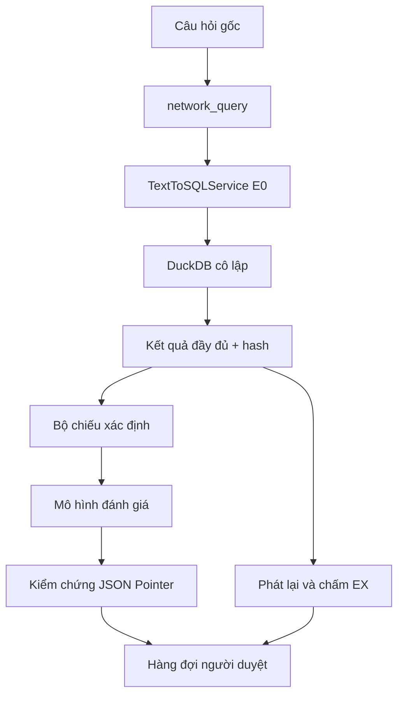

# Thiết kế giao thức 4 cho pipeline truy vấn VinSOC

## 1. Mục tiêu

Giao thức 4 phải hoàn tất một lượt chạy mới đủ 32 ca của pipeline truy vấn mạng, từ câu hỏi tự nhiên đến định tuyến công cụ, sinh SQL, thực thi trên DuckDB, tạo bằng chứng, đánh giá bằng mô hình, kiểm chứng dữ kiện và bàn giao cho người duyệt.

Thay đổi này giải quyết nguyên nhân khiến giao thức 3 dừng ở ca thứ 17: kết quả SQL có 9.780 dòng tạo payload tối thiểu 177.205 byte, vượt giới hạn 32.768 byte trước bước đánh giá. Giải pháp không được tăng tùy tiện giới hạn payload, cắt dữ liệu gốc, bỏ qua ca lỗi hoặc dùng mô hình khác để tóm tắt. Hệ thống phải giữ nguyên kết quả thực thi đầy đủ để kiểm chứng, đồng thời chỉ gửi một bản chiếu có giới hạn và xác định được bằng thuật toán tới mô hình đánh giá.

Lượt chạy giao thức 4 là một phép đo mới. Mọi artifact của giao thức 3 được giữ nguyên và không được tái sử dụng như kết quả của giao thức 4.

## 2. Phạm vi

### 2.1. Trong phạm vi

- Tách kết quả SQL đầy đủ khỏi bản chiếu gửi tới mô hình đánh giá.
- Tạo bản chiếu có giới hạn dung lượng, ổn định và có thể tái lập.
- Thay dẫn chứng theo tên trường bằng JSON Pointer trỏ tới chính xác dữ liệu đã quan sát.
- Kiểm chứng mỗi dẫn chứng bằng kiểu dữ liệu và giá trị chính xác từ kết quả đầy đủ.
- Ghi trạng thái từng ca và tiếp tục ca sau khi gặp lỗi đã biết, có chi phí xác định.
- Dừng toàn bộ lượt chạy khi chi phí không xác định, sổ chi phí chuyển trạng thái kết thúc, hoặc gặp lỗi hệ thống ngoài danh mục cho phép.
- Tạo hợp đồng, cửa sổ chạy, danh tính nguồn, prompt, bộ chiếu, scorer và báo cáo riêng cho giao thức 4.
- Chạy mới toàn bộ 32 ca theo đúng thứ tự đã khóa sau khi tất cả cổng ngoại tuyến và CI đúng SHA đạt.

### 2.2. Ngoài phạm vi

- Không sửa câu hỏi, gold SQL, split, scorer Execution Accuracy hoặc snapshot CTU.
- Không thay model, prompt Text-to-SQL, cấu hình E0 đã được chọn hoặc SQL executor.
- Không chạy E3, R1, frozen, ThreatFox, OTRF hoặc benchmark ngoài 32 ca pipeline CTU.
- Không dùng kết quả giao thức 4 để tuyên bố holdout độc lập.
- Không tự động chấp thuận đánh giá thay cho người thật.
- Không nâng giới hạn 32.768 byte để né lỗi.
- Không thêm một lượt gọi mô hình để tóm tắt kết quả.

## 3. Nguyên tắc bắt buộc

1. **Kết quả đầy đủ là nguồn sự thật.** `columns`, `rows`, `row_count`, `truncated`, `result_sha256`, SQL và danh tính snapshot được lưu nguyên vẹn trong bằng chứng và dùng cho phát lại độc lập.
2. **Bản chiếu chỉ phục vụ bước đánh giá.** Nó không thay thế kết quả đầy đủ, không tham gia chấm Execution Accuracy và không được ghi đè `result_sha256`.
3. **Không suy diễn từ phần bị lược.** Mô hình chỉ được nêu dữ kiện nằm trong bản chiếu hoặc metadata tổng hợp đã được hệ thống tính trực tiếp.
4. **Dẫn chứng phải định địa chỉ chính xác.** Mỗi quan sát dùng `evidence_id`, `json_pointer`, `value`; tên cột đơn lẻ không còn đủ vì bảng nhiều dòng có thể chứa nhiều giá trị cùng tên cột.
5. **Lỗi từng ca không làm mất mẫu số.** Lỗi đã biết được ghi thành record kết thúc của ca và ca sau vẫn chạy. Ca lỗi không bị xóa hoặc thay thế.
6. **Chi phí không rõ thì dừng.** Bất kỳ request nào không xác định được usage/chi phí đều chặn mọi request tiếp theo.
7. **Không ghi đè bằng chứng.** Mỗi cửa sổ chạy và thư mục kết quả chỉ được tạo mới; giao thức 3 luôn bất biến.

## 4. Kiến trúc

### 4.1. Hai lớp biểu diễn kết quả

Sau khi `SqlExecutor` trả kết quả typed, pipeline tạo hai biểu diễn:

- `full_result`: kết quả đầy đủ hiện có, được lưu trong `query_result` evidence và receipt thực thi.
- `assessment_projection`: bản chiếu xác định được tạo từ `full_result`, chỉ dùng trong tool response gửi tới mô hình đánh giá.

Luồng dữ liệu:



Bộ chiếu là một thành phần thuần, không gọi mạng và không sửa đối tượng đầu vào. Cùng một kết quả và cùng phiên bản bộ chiếu phải sinh byte JSON giống nhau.

### 4.2. Hợp đồng bản chiếu

Tool response phải giữ envelope hiện có và thêm metadata bản chiếu cho mỗi `query_result`:

```json
{
  "tool": "network_query",
  "question": "...",
  "status": "succeeded",
  "evidence": [
    {
      "evidence_id": "...",
      "type": "query_result",
      "data": {
        "columns": [],
        "rows": [],
        "row_count": 9780,
        "truncated": false,
        "result_sha256": "..."
      },
      "assessment_projection": {
        "version": "query_result_projection_v1",
        "complete": false,
        "included_rows": 20,
        "omitted_rows": 9760
      }
    }
  ]
}
```

Quy tắc:

- `columns` được giữ nguyên để mô hình hiểu vị trí và kiểu dữ liệu.
- `rows` chứa tối đa 20 dòng đầu theo đúng thứ tự executor trả về.
- `row_count`, `truncated` và `result_sha256` vẫn mô tả kết quả đầy đủ.
- `included_rows` bằng số dòng thực sự có trong bản chiếu.
- `omitted_rows = row_count - included_rows` và không được âm.
- `complete` chỉ đúng khi không lược dòng.
- Toàn bộ JSON sau serialization UTF-8 phải không vượt `NetworkQueryPolicy.MAX_RESPONSE_BYTES`.
- Bộ chiếu thử lần lượt từ 20 dòng xuống 0 dòng cho đến khi envelope hợp lệ. Nếu envelope bắt buộc gồm schema và metadata vẫn vượt giới hạn, ca kết thúc bằng lỗi an toàn `ASSESSMENT_PROJECTION_SCHEMA_LIMIT`; không gửi request đánh giá.
- Không lựa chọn dòng dựa trên nội dung, gold hoặc câu hỏi. Không lấy mẫu ngẫu nhiên.
- `full_result` trong evidence store và artifact không bị thay đổi.

`assessment_projection` chỉ là metadata vận chuyển. Dẫn chứng vẫn trỏ vào `data` của evidence gốc để verifier có thể đối chiếu với nguồn sự thật.

## 5. Hợp đồng quan sát và kiểm chứng dữ kiện

Prompt đánh giá và parser chuyển từ:

```json
{"evidence_id": "...", "field": "column_name", "value": 1}
```

sang:

```json
{"evidence_id": "...", "json_pointer": "/rows/0/2", "value": 1}
```

Áp dụng chuẩn JSON Pointer RFC 6901 với các ràng buộc bổ sung:

- Pointer phải là chuỗi tuyệt đối bắt đầu bằng `/`.
- Chỉ cho phép trỏ tới giá trị scalar JSON: `null`, boolean, number hoặc string.
- Pointer phải giải được trên `evidence.data` đầy đủ.
- Với `query_result`, pointer chỉ được nằm trong các đường đã hiện diện trong bản chiếu: `/row_count`, `/truncated`, `/result_sha256`, `/columns/...` và `/rows/i/j` với `i < included_rows`.
- Không cho phép trỏ tới dòng đã lược, object hoặc array nguyên khối.
- `value` phải cùng kiểu Python và bằng chính xác giá trị tại pointer; `true` không được xem như `1`.
- Cặp `(evidence_id, json_pointer)` không được lặp.
- Evidence được dẫn phải nằm trong `evidence_ids`; phải có ít nhất một evidence kiểu `query_result`.
- Kết quả rỗng được chứng minh bằng `{"json_pointer": "/row_count", "value": 0}`; không được bịa một ô dữ liệu không tồn tại.
- Metadata chiếu như `omitted_rows` không được dùng làm dữ kiện SOC vì nó không nằm trong `evidence.data` gốc.

Cùng một hàm giải JSON Pointer phải được dùng trong parser trực tiếp và bộ dựng báo cáo để tránh sai lệch ngữ nghĩa giữa runtime và hậu kiểm.

## 6. Vòng đời từng ca và cô lập lỗi

### 6.1. Trạng thái

Mỗi ca có một record riêng với một trong các trạng thái:

| Trạng thái | Ý nghĩa | Có được chạy tiếp ca sau? |
|---|---|---|
| `not_started` | Chưa gửi request nào cho ca | Có |
| `running` | Ca đang xử lý và có checkpoint | Không áp dụng |
| `completed` | Đã có kết quả kỹ thuật cuối cùng | Có |
| `known_error` | Lỗi thuộc danh mục cho phép, usage và chi phí đã xác định | Có |
| `unknown_cost` | Có request nhưng không xác định được usage/chi phí | Không |
| `fatal_error` | Lỗi hệ thống, danh tính, dữ liệu hoặc lập trình ngoài danh mục | Không |

`completed` và `known_error` là trạng thái kết thúc của ca. `unknown_cost` và `fatal_error` kết thúc toàn bộ lượt chạy.

### 6.2. Lỗi được phép cô lập

Runner chỉ tiếp tục khi đồng thời thỏa các điều kiện:

- lỗi xảy ra sau khi ca đã được nhận diện;
- không có request đang treo;
- sổ chi phí xác nhận `cost_unknown == false` và không ở trạng thái terminal;
- lỗi thuộc danh mục công khai, cố định của giao thức, ví dụ lỗi sinh SQL đã có mã, lỗi thực thi SQL đã cho phép, lỗi giới hạn bản chiếu, lỗi hợp đồng assessment hoặc lỗi kiểm chứng dữ kiện;
- record của ca đã được ghi nguyên tử với `failure_stage`, `failure_category`, cost events và dữ liệu trung gian an toàn.

Không ghi raw exception, prompt, response body, key hoặc traceback vào artifact công khai. Lỗi ngoài danh mục chuyển ca thành `fatal_error`, ghi tên lớp lỗi an toàn và dừng lượt chạy. Không dùng `except Exception` để âm thầm biến lỗi lập trình thành một ca sai bình thường.

### 6.3. Tính lặp an toàn

- Mỗi protocol 4 release có `execution_id`, `release_sha256` và cửa sổ sổ cái riêng.
- File trạng thái ca được ghi nguyên tử sau mỗi request nhận được và sau mỗi chuyển trạng thái.
- Runner không gửi lại request cho ca đã ở `completed` hoặc `known_error` trong cùng `execution_id`.
- Nếu tiến trình dừng khi ca là `running`, chỉ được tiếp tục khi journal chứng minh không có request chưa đối soát. Nếu không chứng minh được, chuyển `unknown_cost` và dừng.
- Lượt chính thức ban đầu phải bắt đầu với đủ 32 ca `not_started`; không nhập checkpoint từ giao thức 3.
- Artifact đích không được tồn tại trước lần khởi tạo. Việc tiếp tục, nếu cần, chỉ dùng chính thư mục và release của giao thức 4 đã tạo.

## 7. Hợp đồng giao thức 4 và chuỗi bằng chứng

Giao thức 4 tạo phiên bản mới cho:

- release contract và `window_id`;
- prompt đánh giá;
- schema quan sát;
- bộ chiếu kết quả;
- normalization/reporting của pipeline;
- source hash và test identity.

Release phải khóa tối thiểu:

- implementation Git SHA;
- 32 `case_id` và câu hỏi nguyên gốc theo đúng thứ tự;
- model và tham số của routing, R2 và assessment;
- selection lock E0;
- snapshot binary/logical SHA;
- benchmark identity, scorer identity và runtime source SHA;
- assessment prompt SHA;
- projection version/source SHA;
- JSON Pointer verifier source SHA;
- giá, cận token, hạn mức và đối soát chi phí;
- CI Python 3.11/3.12 của đúng implementation SHA.

Không được dùng release giao thức 3 để mở giao thức 4. Workflow trả phí chỉ được chạy thủ công và không có trigger `push`.

## 8. Báo cáo và chỉ số

Mẫu số chính thức của pipeline luôn là 32. Báo cáo phải phân biệt:

- `completed`: ca kết thúc kỹ thuật bình thường;
- `known_error`: ca kết thúc bằng lỗi đã phân loại;
- `unknown_cost`/`fatal_error`: lượt chạy bị dừng;
- `missing`: ca chưa từng được bắt đầu vì lượt chạy bị dừng.

Chỉ công bố tỷ lệ toàn bộ pipeline khi cả 32 ca đều ở `completed` hoặc `known_error`, không có unknown cost, chuỗi provenance hợp lệ và kiểm toán artifact đạt. Một `known_error` được tính sai ở các bước không thể hoàn tất, nhưng các bước đã có receipt hợp lệ vẫn được đo độc lập. Không điền `false` cho một bước chưa được thực hiện nếu lượt chạy đã dừng toàn cục; trường đó giữ `null`.

Các chỉ số bắt buộc:

- độ chính xác định tuyến vào `network_query`;
- tỷ lệ runtime dùng đúng `TextToSQLService` đã khóa;
- Execution Accuracy tích hợp;
- tính hợp lệ provenance và phát lại;
- tỷ lệ dữ kiện assessment được kiểm chứng;
- tỷ lệ hoàn tất kỹ thuật toàn pipeline;
- độ phủ duyệt người thật và tỷ lệ được chấp thuận;
- số request, response, token, chi phí đã biết và số call chi phí không rõ theo vai trò;
- phân bố lỗi theo `failure_stage` và `failure_category`;
- số ca dùng bản chiếu đầy đủ, số ca bị lược và tổng số dòng bị lược.

Artifact JSON đầy đủ là nguồn sự thật. HTML chỉ là bản biểu diễn và phải khớp JSON theo test. Lượt chạy không được gọi là “hoàn tất end-to-end” nếu chưa đủ 32 trạng thái kết thúc hoặc còn chi phí không rõ. Duyệt người thật có thể hoàn tất sau lượt kỹ thuật và phải gắn hash receipt của từng ca.

## 9. An toàn và bảo mật

- Evidence và ô dữ liệu tiếp tục được xem là dữ liệu không tin cậy, không phải chỉ dẫn.
- Không để nội dung DB thay đổi system prompt hoặc gọi thêm tool.
- Không lưu API key, raw headers, raw exception, full provider response hoặc prompt ngoài artifact riêng đã cho phép.
- Tool call vẫn chỉ nhận đúng câu hỏi nguyên gốc; model không được gửi SQL hay đường dẫn DB vào tool.
- SQL executor vẫn chỉ đọc, giới hạn thời gian/dòng và chạy cô lập.
- Không thay đổi các cổng chi phí, số lần retry bằng 0 hoặc điều kiện dừng unknown cost.
- Bản chiếu phải escape JSON chuẩn; JSON Pointer phải xử lý đúng `~0` và `~1` và từ chối escape sai.

## 10. Kiểm thử bắt buộc

### 10.1. Bộ chiếu

- Kết quả nhỏ được giữ đủ và `complete == true`.
- Kết quả 9.780 dòng tạo payload dưới hoặc bằng 32.768 byte mà `full_result` và hash không đổi.
- Cùng input sinh byte JSON giống nhau.
- Bảng rộng giảm số dòng đến khi vừa giới hạn.
- Schema bắt buộc tự nó quá lớn tạo `ASSESSMENT_PROJECTION_SCHEMA_LIMIT` trước request đánh giá.
- Kết quả rỗng giữ `row_count == 0`, `rows == []`.
- Unicode được tính theo số byte UTF-8, không theo số ký tự.

### 10.2. JSON Pointer

- Trỏ đúng metadata scalar và ô ở nhiều dòng/cột.
- Phân biệt nghiêm ngặt boolean với integer, null và string.
- Hỗ trợ escape RFC 6901 hợp lệ; từ chối pointer sai, object/array, dòng bị lược và pointer lặp.
- Parser runtime và reporting verifier cho cùng kết quả trên cùng fixture.
- Quan sát theo hợp đồng cũ dùng `field` bị từ chối trong protocol 4 nhưng artifact protocol 3 vẫn đọc được bằng adapter lịch sử.

### 10.3. Cô lập lỗi

- Một ca lỗi assessment có chi phí rõ tạo `known_error`, ca kế tiếp vẫn chạy.
- Lỗi giới hạn schema không gọi assessment và ca kế tiếp vẫn chạy.
- Request thiếu usage tạo `unknown_cost` và không có request sau đó.
- Lỗi ngoài danh mục tạo `fatal_error` và dừng.
- Chạy tiếp cùng `execution_id` không gửi lại ca đã kết thúc.
- Không thể nhập checkpoint, release hoặc cửa sổ từ protocol 3.
- Artifact lỗi không chứa secret, raw response hoặc raw traceback.

### 10.4. Báo cáo và hồi quy

- 32 ca kết thúc cho phép tính tỷ lệ với mẫu số 32, kể cả có `known_error`.
- Lượt dừng giữa chừng giữ tỷ lệ chính thức `null` và số ca thiếu chính xác.
- JSON và HTML khớp từng trạng thái, chỉ số và chi phí.
- Toàn bộ test hiện có của protocol 3 vẫn đạt và artifact cũ không đổi hash.
- Full suite, `compileall`, kiểm tra khoảng trắng và kiểm tra bảo toàn file đều đạt.

## 11. Trình tự triển khai và chạy thật

1. Khóa test cho bộ chiếu và JSON Pointer trước khi sửa runtime.
2. Triển khai bộ chiếu và hợp đồng assessment mới.
3. Triển khai trạng thái từng ca, danh mục lỗi và tiếp tục an toàn.
4. Tạo contract/preflight/report/workflow protocol 4, giữ protocol 3 chỉ đọc.
5. Chạy focused tests, full suite, `compileall`, kiểm tra diff và bảo toàn artifact.
6. Commit/push mã; chờ CI Python 3.11 và 3.12 xanh trên đúng SHA.
7. Tạo preflight mới, xác minh đủ 32 ca, dữ liệu, source hash, selection E0, tài khoản, giá và cận chi phí.
8. Chạy đúng một lượt mới đủ 32 ca. Không retry riêng ca sai và không đổi mã giữa lượt.
9. Kiểm toán JSON, ledger, hash, chi phí và HTML; sau đó dừng để người thật duyệt.

Nếu lượt thật dừng vì `unknown_cost` hoặc `fatal_error`, không tự chạy lần hai. Nếu hoàn tất kỹ thuật, vẫn không tự chấp thuận 32 assessment thay cho người thật.

## 12. Tiêu chí nghiệm thu

Thiết kế được xem là triển khai đạt khi đồng thời thỏa:

1. Giao thức 3 và mọi artifact lịch sử không đổi.
2. Bộ chiếu xử lý được fixture tương đương ca 17 mà payload không vượt 32.768 byte và kết quả đầy đủ vẫn phát lại đúng hash.
3. Mọi quan sát mới dùng JSON Pointer và được đối chiếu chính xác với typed full result.
4. Ca lỗi đã biết không làm dừng ca sau; unknown cost hoặc lỗi ngoài danh mục luôn dừng.
5. Cả 32 ca của lượt mới có record kết thúc `completed` hoặc `known_error`, không có ca thiếu và không có chi phí không rõ.
6. Mọi số liệu headline dùng mẫu số 32 và được tái tạo từ artifact JSON.
7. CI Python 3.11/3.12 xanh trên đúng implementation SHA và preflight của lượt thật khóa cùng SHA đó.
8. Artifact bàn giao gồm report JSON, từng case receipt, ledger/cost summary, provenance/hash manifest, HTML chỉ đọc và hàng đợi duyệt người thật.
9. Báo cáo nêu rõ đây là pipeline CTU32 trên bộ development/evaluation đã khóa, không phải holdout độc lập.
